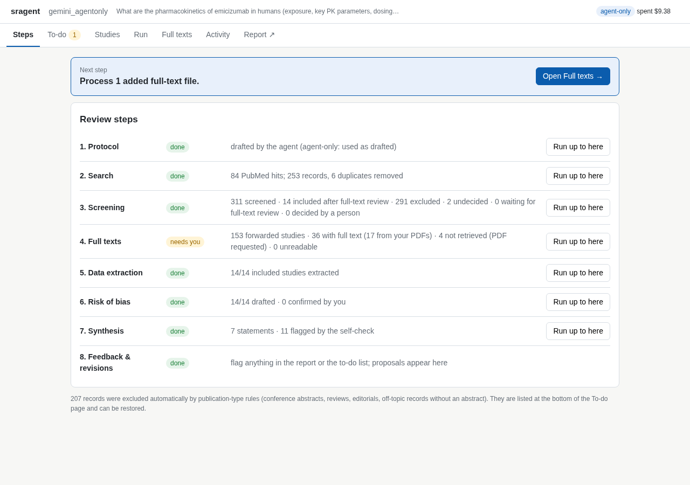
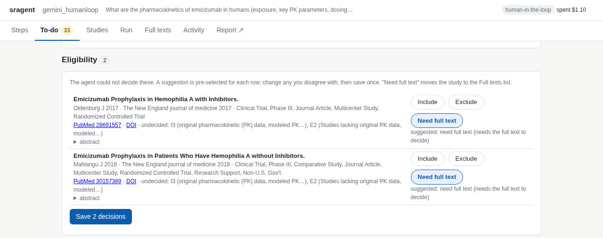

# sragent · Guide

A human-in-the-loop agent for systematic reviews, built from the proposal *"A Human-in-the-Loop Agent Platform for Systematic Reviews"* and the advisor's comment:

> The interesting parts of this project are the hypotheses about what the LLM will do. Perhaps you will get a nice clear signal from LLM as a judge, in which case you can go light on the difficult human judgment evals.

So the code does two things.

1. **The agent.** It runs the whole review workflow (planning, search, screening, extraction, risk of bias, synthesis, report). Every output is a versioned node in a dependency graph and is linked to the source sentences that support it (section and character offsets, so every claim is trackable). User feedback is checked against that evidence and then propagated to every affected output.
2. **The evaluation.** Each claim is turned into hypotheses about LLM behaviour. Gold answers come **by construction** (planted errors with known corrections, plus a published benchmark), so an LLM judge can score most things. The judge itself is validated with known-answer controls and a second judge, and only a small audit sheet is left for humans.

Contents

1. Quick start
2. Repository layout
3. Environment setup (conda, API keys)
4. Local mode (your own vLLM servers)
5. Data, and why these data
6. Workflow
7. Usage (web interface, PDFs, command line)
8. Inputs and outputs
9. Validation elements inside the agent
10. Evaluation design (hypotheses, Claim 1, Claim 2, judge validation)
11. Results (v2 scaled run, v1 pilot)
12. Cost control
13. Limitations and next steps
14. Troubleshooting

---

## 1. Quick start

```bash
conda env create --prefix "$PWD/.conda" --file environment.yml && conda activate "$PWD/.conda"
python -m pip install -e ".[dev]"
cp api_env.example.yaml api_env.yaml  # your keys; never commit this file
pytest -q tests/                      # offline tests with a mock LLM (no cost)

# a real review (no known answer): copy the template, fill in topic.yaml, open it in the web interface
cp -r configs/review/_template configs/review/<your_topic>
sragent ui --config configs/review/<your_topic>/run.yaml          # opens http://127.0.0.1:8765

# the benchmark (known answer): the main results of section 11.0
sragent run    --config configs/benchmark/emicizumab_pk/gemini_agentonly.yaml
sragent eval   --config configs/benchmark/emicizumab_pk/gemini_agentonly.yaml --suite all

# the same on your own vLLM servers (free; section 4): a run file that includes ../../models/local.yaml
sragent local-endpoints --config configs/benchmark/emicizumab_pk/gemini_agentonly.yaml --probe
```

`configs/benchmark/` holds topics with a known answer (to measure the agent; `sragent eval` works); `configs/review/` holds real reviews (no known answer). A run file's path is its name: `configs/<kind>/<topic>/<run>.yaml` writes to `runs/<kind>/<topic>/<run>/`. `sragent runs` lists every run file with the state of its outputs; `configs/README.md` explains the files.

Open `runs/<name>/report_evidence.html` in a browser to inspect the review with its evidence (the UI's "Report" tab shows the same page).

---

## 2. Repository layout

```
SRAgent/
  README.md                      short overview
  GUIDE.md                       this file
  api_env.example.yaml           template for api_env.yaml (keys; never committed)
  local_endpoints.yaml           your vLLM servers and the roles each may serve (section 4)
  environment.yml                client env (CPU; vLLM runs in your server environment)
  pyproject.toml                 installs the `sragent` command
  configs/                       see configs/README.md
    models/                      WHICH LLMs do the work (agent, judge, reviewer, judge2)
      gemini.yaml                  Gemini for every role
      local.yaml                   your own vLLM servers (endpoint pool settings; servers in local_endpoints.yaml)
    benchmark/                   topics WITH a known answer: measure the agent (`sragent eval`)
      emicizumab_pk/
        topic.yaml                   question, seed criteria, records, extraction fields, RoB domains
        gemini_agentonly.yaml        all records, agent only (evaluation condition 1) -> main results
    review/                      topics WITHOUT a known answer: real reviews
      _template/                   topic.yaml + run.yaml to copy
  sragent/
    llm.py         provider layer (openai | gemini | local | mock), disk cache, cost tracker, budget
    local.py       reloadable vLLM endpoint pool, managed SSH tunnels, `sragent local-endpoints`
    config.py      config loading with `include:` layering, DEFAULTS (every key), key loading from api_env.yaml
    context.py     the run context (config, run folder, store, LLM clients)
    store.py       ReviewStore = versioned nodes + dependency graph + change log
    evidence.py    sentence segmentation and located evidence (ids -> section + offsets), section-aware packing
    terms.py       term validation via RxNorm, PubChem, ChEMBL, MONDO (OLS4)
    rules.py       deterministic screening rules (conference abstracts, reviews, off-topic, date range)
    gold.py        known answers of benchmark topics, kept outside the agent's store (eval_private/gold.json)
    provenance.py  human-involvement mode (agent_only / human_in_the_loop) and the log of human input
    prompts.py     every prompt in one file
    sources/       PubMed, Europe PMC, Crossref, OpenAlex, Unpaywall, SYNERGY loader, cached HTTP
    stages/        planning, search, screening, fulltext, snowball (citation chasing), extraction, rob, synthesis, report
    feedback.py    feedback -> verify -> revise -> propagate -> propose / accept
    pipeline.py    orchestration (resumable)
    todos.py       the human to-do list (questions, options, applying answers)
    sync.py        updates outputs after human decisions or added PDFs (dependency-aware)
    actions.py     comments, manual edits (no LLM, versioned), per-study re-runs and updates (proposals)
    studies.py     study list / study page / exports / global history views
    estimate.py    cost estimate of the remaining work per model
    pdf.py         PDF -> page-marked text
    docparse.py    full-text parsing: Azure Content Understanding, pdftotext, page images, supplements
    ui/            local web interface (server.py, steps.py, static/index.html)
    cli.py         command line
    eval/          run_all (one evaluation run), screening_eval, stagewise, grounding_eval, synthesis_eval,
                   inject, claim1, claim2, judge_validation, stats, common
  tests/           offline tests + a schema-valid mock LLM
  data/            resolved benchmark records (donners_2021_records.jsonl)
  runs/          run outputs (git-ignored); the same path as the run file under configs/
    benchmark/emicizumab_pk/gemini_agentonly/   the main results (section 11.0); eval/README.md lists its evaluations
```

---

## 3. Environment setup

### 3.1 Conda (client side, any machine including an OSC login node)

```bash
conda env create --prefix "$PWD/.conda" --file environment.yml
conda activate "$PWD/.conda"
python -m pip install -e ".[dev]"   # provides the `sragent` command
python -m pytest -q tests/          # offline tests, a few seconds; network access is blocked in tests
```

Python 3.10+ works. Dependencies are small (openai, pyyaml, requests, rapidfuzz, pandas).

### 3.2 API keys

Keys are read from `api_env.yaml`, never from the configs. The model files point to it with `api_env: ../../api_env.yaml` (paths in a config file are relative to that file, so the file sits in the project root). The loader tolerates the mixed `key: "value"` and `KEY= value` lines in your file. Environment variables `OPENAI_API_KEY`, `GEMINI_API_KEY`, `LOCAL_API_KEY` override the file. `api_env.example.yaml` lists the keys.

Add `api_env.yaml` to `.gitignore` (already done in this repo). Other keys read from the same file:

| Key | Used for | Needed? |
|---|---|---|
| `AZURE_CONTENT_AI_ENDPOINT`, `AZURE_CONTENT_AI_API_KEY` (or `azure_cu_endpoint`, `azure_cu_key`) | Azure AI Content Understanding: PDF -> sections, tables, figure descriptions (section 7.2) | optional; without it PDFs use the local parser |
| `contact_email` | Unpaywall (required by its terms), polite access to OpenAlex / NCBI | recommended |
| `openalex_api_key` | OpenAlex citation graph and OA locations; the free shared budget is often used up | optional (NCBI links are the fallback) |
| `ncbi_api_key` | higher E-utilities rate limit | optional |

### 3.3 Optional

`contact_email` and `ncbi_api_key` in a config make NCBI E-utilities faster and more polite (10 instead of 3 requests per second).

---

## 4. Local mode (your own vLLM servers)

The same pipeline runs on vLLM servers that are already running, for example on OSC GPU nodes. SRAgent does not start vLLM; it keeps a live list of endpoints and spreads requests over them. The agent side only needs HTTP and SSH clients.

### 4.1 Register the servers

```bash
sragent local-endpoints --config configs/benchmark/emicizumab_pk/gemini_agentonly.yaml --nodes <node1> <node2> --probe
sragent run --config configs/benchmark/emicizumab_pk/local_agentonly.yaml
```

`local-endpoints` takes any run file (it only reads the endpoint list path). To run on local servers, copy a run file and include `../../models/local.yaml` instead of `gemini.yaml`; its outputs go to `runs/.../local_agentonly/`.

* `--nodes` rewrites `local_endpoints.yaml` (project root) with one entry per SSH host. `--add` appends to the current list instead, and `--roles agent` (or `judge`, `reviewer`, `judge2`) restricts the new entries to those roles; the file's comment header is kept. SRAgent opens its own SSH tunnel to each node (`BatchMode`, the host key must already be known) and closes only the tunnels it started.
* `--urls http://127.0.0.1:18002/v1 ...` registers servers you reach through your own tunnel instead.
* `--probe` connects and lists the served models (no inference).
* Rerun it with the full new list at any time; active runs pick it up. Removed endpoints finish their active requests, a failed endpoint cools down and is retried, and an invalid update is ignored (the last valid list is kept).

The file format is explained in the comments of `local_endpoints.yaml`: `ssh_host` (with `remote_host`, `remote_port`) or `url`, `model` (`auto` for a single-model server, or the served model ID), `max_concurrency`, and optionally `roles`, `revision`, `api_key_env` and `enabled`.

### 4.2 Backend settings

`configs/models/local.yaml` sets `provider: local` and `model: auto`, plus the pool settings under `local:`:

* `poll_interval` and `retry_interval` (cool-down after a failed endpoint), `probe_timeout`, and `wait_timeout` (`null` waits for endpoints until you cancel).
* `concurrency` is the number of parallel requests from this process; `max_concurrency` per endpoint limits the active requests on each server.
* Responses are cached per endpoint and `revision`. Change `revision` when different weights are served under the same model ID.
* JSON output uses `response_format: json_object` (`json_mode: true`). The parser strips `<think>` blocks and code fences, and one repair retry is made if the JSON is invalid. Model-specific request options go in `extra_body` (e.g. Qwen `chat_template_kwargs`).
* If a server needs a key, put `local_api_key` in `api_env.yaml` or set `LOCAL_API_KEY` (or name another variable with `api_key_env` per endpoint).
* Keep `context_chars: 30000` and `fulltext_screen_chars: 12000` in the run file so prompts fit a 32k-token context; longer papers are read in parts.

### 4.3 Judge choice in local mode

By default the judge, reviewer and judge2 roles also use the local model (free). For the paper, a judge from a **different model family** than the agent is better (it reduces self-preference). A cheap compromise is a local agent, a Gemini Pro judge and `gemma-4-31b-it` as judge2 (an open model reachable with the same Gemini key, almost free; it is what the v2 run used). Override `roles.judge` and `roles.judge2` in your run file as in `configs/models/gemini.yaml`. The judge validation suite (section 10.5) tells you whether the local judge agrees with an API judge, so you can measure this instead of guessing.

---

## 5. Data, and why these data

| Data | Source | Used for | Why |
|---|---|---|---|
| SYNERGY `Donners_2021` | github.com/asreview/synergy-dataset | gold screening labels, study set | Published review on **emicizumab pharmacokinetics** (Donners et al., Clin Pharmacokinet 2021). Bounded topic, close to your pharmacometrics work, small (253 unique records with identifiers, 15 included), published eligibility text to seed the protocol, open licence. |
| PubMed E-utilities | NCBI | search execution, record metadata (title, abstract, MeSH, publication type, PMCID) | standard biomedical database, free |
| Crossref | api.crossref.org | metadata for records not in PubMed (conference abstracts) | about a third of the SYNERGY records are ASH/ISTH abstracts |
| Europe PMC | ebi.ac.uk/europepmc | open-access full text (JATS XML) | the only free full-text source with a stable API; non-OA papers fall back to the abstract |
| RxNorm (RxNav) | NLM | drug normalisation, brand/ingredient synonyms | clinical drug vocabulary; maps Hemlibra and ACE910 to emicizumab |
| PubChem | NCBI | drug identity (compound or substance; biologics are substances) | broad chemical coverage |
| ChEMBL | EBI | drug identity, synonyms, development phase | covers research codes such as ACE910 |
| MONDO (via OLS4) | EBI | disease normalisation | unified disease ontology with cross-references |

How the benchmark is loaded. SYNERGY gives DOIs and labels. OpenAlex (SYNERGY's own source) is IP-rate-limited on shared networks, so `sources/synergy.py` resolves DOIs to PMIDs in PubMed in batches and falls back to Crossref. A handful of DOIs (mostly duplicated conference abstracts) could not be resolved, and records without any identifier (all labelled excluded) are dropped. The result is cached in `data/donners_2021_records.jsonl`. Labels are kept in the record but are **never put in a prompt**.

Other SYNERGY reviews (26 in total) can be used by changing `records.synergy_key` and writing a topic file. A non-benchmark topic uses `records.source: pubmed` (live search) or `file` (your own JSONL export).

---

## 6. Workflow

```
 question + seed criteria
        │
  [1] PLAN ──► protocol.yaml (PICO, atomic criteria I*/E*/P*, key concepts)
        │        key concepts validated in RxNorm/PubChem/ChEMBL/MONDO -> synonyms
        │        HUMAN CHECKPOINT: edit protocol.yaml, then `sragent rescreen` or rerun
  [2] SEARCH ─► LLM writes PubMed query using DB synonyms; executed; strategy, hit count,
        │        query translation recorded; de-duplication by PMID, DOI, fuzzy title
  [3] SCREEN ─► title/abstract: per-criterion met / not_met / unclear + cited sentence ids;
        │        decision by a transparent rule (see 9.3): EXCLUDE or FORWARD only (nothing is
        │        included at this stage)
  [3b] FULL TEXT ► every forwarded record needs its full text: your PDF > Europe PMC open access
        │        > a legal open-access copy (Unpaywall / OpenAlex); PDFs parsed by Azure Content
        │        Understanding when configured. The whole text is kept; prompts pack it by section.
        │        Not obtained -> "full text not retrieved" + PDF request (PMID/DOI, reason);
        │        unreadable file -> "full text unreadable"; otherwise full-text screening with the
        │        same rule -> include / exclude / undecided ("awaiting classification")
  [3c] CITATION CHASING ► references and citing works of every included study (OpenAlex, or NCBI
        │        links as fallback), same date limit as the search; new candidates that mention an
        │        intervention concept go through rules, title/abstract and full-text review
  [4] EXTRACT ► topic fields, each value + cited sentence ids (1-4, anywhere); drug/disease
        │        entities validated in external DBs
  [5] RoB ────► domain judgments + rationale + cited sentences (draft)
  [6] SYNTHESIS ► 4-8 statements, each with cited study ids and a scope; each statement
        │        self-checked against the cited data (supported / partial / unsupported)
  [7] REPORT ─► report.md (report only) and report_evidence.html (evidence linked)
        │
  FEEDBACK ◄──► verify against evidence -> revise target -> find related outputs in the graph
                -> revise affected ones -> change set -> human accepts / rejects
```

### 6.1 The dependency graph

| Node id | Content | Depends on |
|---|---|---|
| `protocol`, `crit:I1` | protocol, criteria | |
| `search` | strategy and hits | protocol |
| `rec:<id>` | bibliographic record | search |
| `screen:<id>` | eligibility decision | rec, protocol, criteria (+ ft at full-text stage) |
| `ft:<id>` | full text or abstract | rec |
| `ext:<id>` | extracted data | screen, ft, protocol |
| `rob:<id>` | risk-of-bias draft | ext, ft |
| `syn:S<k>` | synthesis statement | ext and rob of every cited study |
| `report` | rendered report | synthesis statements |

`<id>` is the PMID when available (e.g. `ext:31003963`), otherwise a stable hash (`d6d14f1146b`). Every update keeps the previous version in `history`, and every change is written to `store_changelog.jsonl` with actor (agent, user, injector) and reason.

`related(node)` is what a dependency-aware revision revisits. It is the node's descendants plus the other outputs derived from the same study (so a corrected population can reach the eligibility decision as well as the synthesis).

---

## 7. Usage

### 7.1 The web interface (recommended)

```bash
sragent ui --config configs/review/<your_topic>/run.yaml      # opens http://127.0.0.1:8765
# on OSC or a remote machine:  sragent ui --config ... --no-browser, then  ssh -N -L 8765:localhost:8765 <host>
```

It runs on your machine only (standard library web server, no extra install). Every page starts with one **Next step** banner that says, in plain words, the single most useful thing to do now, with a button that takes you there. You never have to work out the order yourself.

| Tab | What you do there |
|---|---|
| **Steps** | The Next step banner, then one row per review step with its status (`done`, `to do`, `needs you`), a one-line summary, and **Run up to here**. |
| **To-do** | Everything that needs you, in the order you should do it. Repetitive decisions are tables with pre-filled suggestions and one Save button, not one card each (see below). |
| **Run** | What to run (continue the review up to a stage, process added PDFs, update outputs after your decisions, or an evaluation suite), the **agent model** (API models with their list price per 1M tokens; local models from the endpoint list of section 4, free), reasoning effort, max records and a **spending cap**. A cost estimate for exactly that choice updates live. **Test model** makes one tiny call. **Run** starts a background job with a live log; **Stop** ends it cleanly. For a real review (no known answer) the record cap and the evaluation are not offered. |
| **Studies** | Every record with its current status (included / pending / excluded, and by whom: agent, rule or you), the reason, source used, open flags, RoB, which synthesis statements cite it and comments. Filter, search, copy the PMIDs of what is shown, download the table (CSV) or everything (JSON). A box to comment on the whole review. Click a row for the **study page** (7.1b). |
| **Full texts** | A copyable, comma-separated **PMID list** with **Open in PubMed**, DOIs for records without a PMID, the folder path, the file name for each study (`<PMID>.pdf`), and **Process added PDFs**. Per study: "decide without it" or "not obtainable". |
| **Activity** | The global history. **LLM jobs**: every agent task started from the interface (runs, re-runs, comments sent to the agent, updates after your edits) with status (queued, running, done, failed, cancelled), model, cost, duration and the full log; queued jobs can be cancelled. **Agent proposals** (all change sets, accept / reject the open ones), **Comments**, **Your decisions**, **Change history** (every version of every output, filter by agent / you / rules or by output id, CSV download) and **LLM calls by stage**. |
| **Report** | The evidence-linked report. Under every item, *comment / ask the agent* sends your comment straight to the agent (or saves it as a comment only). |

What the To-do page contains, top to bottom

| Section | What you do | Effort |
|---|---|---|
| Protocol | Approve the criteria, or say you edited `protocol.yaml` (decisions are re-derived without LLM calls). | one click |
| The agent's answers to your feedback | Accept or reject a proposed revision (before and after shown), or, when the agent disagreed with you, agree or "apply my change anyway". | one click each |
| **Eligibility** (one table) | Only studies the agent genuinely could not decide. Each row shows the title, PubMed/DOI links, which criteria are undecided, the abstract, and a **pre-selected suggestion** (Include / Exclude + reason / Need full text). Change what you disagree with and press **Save** once. "Need full text" moves the study to the PMID list. | one Save |
| Out-of-date outputs | **Update now**: extracts and assesses newly included studies and revises only the affected synthesis statements. | one click |
| Full texts | The PMID list to copy into PubMed, the folder, and Process added PDFs. | copy, download, one click |
| Points the agent flagged | A few self-check or evidence flags: "it is fine" or "ask the agent to fix it" with your comment. | a few |
| Your edits | After a manual edit (7.1b) of an output that others depend on: "Yes, propose updates" (the agent revises only the dependent outputs, proposal for your approval) or "No, they are fine". | one click |
| **Risk of bias** (one table) | Every domain judgment as a coloured chip (hover for the rationale). Tick the rows you agree with, **Confirm selected**; "change" opens all domains at once (one drop-down per domain, with the agent's rationale beside it): **Save changes and confirm**, or **Ask the agent to re-assess instead** with your note. | one click |
| Excluded automatically | No action needed. Records excluded by the screening rules (section 9.3b), grouped by rule with the reason; **restore** sends one back to the eligibility table. | none |

Decisions stay in sync: excluding a study removes it from the PMID list and from risk of bias immediately; "Update now" (or the to-do that appears after any change) brings extraction and synthesis in line.

Screenshots of the main results (`benchmark/emicizumab_pk/gemini_agentonly`, agent-only): `docs/ui_steps.png`, `docs/ui_todo.png` (in agent-only mode the to-do list only asks for full texts), `docs/ui_fulltexts.png`, `docs/ui_run.png`, `docs/ui_studies.png`, `docs/ui_study_page.png`, `docs/ui_activity.png`. The eligibility and risk-of-bias tables appear only in human-in-the-loop mode; `docs/ui_todo_eligibility.png` and `docs/ui_todo_rob.png` show them on a copy of the same review opened that way.





Every answer goes to `human_decisions.jsonl` (time-stamped, with your note), which is both an audit trail and research data on human-agent interaction. Answers given while a job is running are queued and applied when it finishes, so a job never overwrites your decisions. Answers that need the LLM (fix this, update now, process PDFs) start a job with the model last chosen in the Run tab.

### 7.1b The study page: everything about one study, and what you can do with it

Open it from the Studies tab, a RoB row ("study page") or any job in Activity.

| Section | Shows | You can |
|---|---|---|
| Header | title, authors, journal, PubMed / DOI / PMC / Europe PMC links, status and reason, which source the agent used (abstract or full text and where it came from), PDF state | **Copy as Markdown**, download `.md` or `.json` (the full text included) |
| Ask the agent | | **Re-run one step** (screening, extraction, risk of bias) with **any model** from the list (API with price, or local) and an optional **note** that is added to the prompt. The result and, if ticked, the revisions it causes downstream are computed on a copy and shown as a **proposal**; accepting it updates all of them together (for screening, an exclusion removes the study from RoB and synthesis, an inclusion extracts, assesses and integrates it). The cost estimate is shown before you click. |
| Eligibility | decision, stage, the rule or your decision if any, the agent's reason, every criterion with its assessment and cited sentences | **Edit** the decision (include / exclude with reason / awaiting) without the LLM |
| Extracted data | each value with its sentence ids and section, database term checks, "edited by you" marks | **Edit values** without the LLM |
| Risk of bias | each domain with judgment, rationale and evidence; the agent's original judgment when you changed it | **Edit domains** (judgment and rationale, several at once) without the LLM |
| Cited in the synthesis | the statements that cite this study, with self-check status | **edit** a statement's text and citations without the LLM |
| Change proposals | every proposal that touched this study (feedback, re-runs, updates), with what would change | accept / reject open ones |
| Flags | every flag on the study's outputs, open and resolved, with source (evidence check, term validation, self-check, feedback, your edit) and resolution | |
| Comments | your comments on the study or on one of its outputs | **Send to the agent** (it checks the comment against the source; proposes a revision or explains why not) or **Save as a comment only**; mark resolved |
| History | every version of every output of this study: when, what changed (e.g. `sample_size: "48" → "64"`), who (agent, rule, you) and why (including your notes) | |

Manual edits never call the LLM. Each one is a new version with `actor=user` and your note in the history; earlier versions stay in `store.json`. If other outputs use the one you edited (for example synthesis statements citing a value), a "Your edits" to-do asks whether the agent should propose updates to them.

All writes are serialized: while a job is running, your answers, edits and comments are queued (the interface says so) and applied the moment it finishes, so no job overwrites them.

### 7.2 Full texts: where they come from, how they are read

**Retrieval order** for every record forwarded to full-text review:
1. your file in `runs/<name>/fulltext/<PMID>.pdf` (or `.txt`);
2. Europe PMC open-access JATS XML (the PMC open-access subset plus Europe PMC manuscripts; NCBI PMC serves the same subset, so it is not queried separately; articles that are free to read on PMC but not open-licensed cannot be downloaded by either API);
3. a legal open-access copy found by Unpaywall (needs `contact_email`) or OpenAlex, downloaded from a repository or the publisher. Many publisher sites refuse scripts; the link is then shown in the PDF request so you can download it in a browser;
4. otherwise the record becomes "full text not retrieved" and is requested.

**Reading.** The whole text is stored (`max_stored_chars`, 400,000). Nothing is cut blindly any more: prompts get the text **packed by section** (references, acknowledgements, funding, conflicts and similar sections are dropped; abstract, results, tables and methods come before discussion and introduction; omitted parts are marked), and a paper longer than the prompt budget (`context_chars`) is **read in consecutive parts** with the same sentence ids; values that differ between parts are merged in one extra call. JATS tables stay where they occur as `Table N: caption` sections with `cell | cell` rows (each row a citable sentence); figure captions are kept.

**PDF parser** (`pdf_parser: auto`). With Azure Content Understanding keys, PDFs go to `prebuilt-documentSearch`: section headings, tables and, for figures, a generated description plus the plotted values where it can read them. These appear as `Figure (machine-read, approximate)` sections, so values read from a plot are never presented as reported numbers. Results are cached next to the PDF (`fulltext/.parsed/`), so each file is analysed and billed once. `azure_cu_analyzer: prebuilt-layout` is cheaper (no figure descriptions). Without Azure, poppler/pypdf text is used; `vision_pages: true` additionally sends pages that contain tables or figures to the agent's multimodal model for transcription.

**Supplements.** Files named `<PMID>_supp1.pdf` (also `.txt`, `.csv`, `.md`) are appended as `Supplement: <file>` sections. Supplements listed in the JATS XML are recorded on the study page.

**Requests.** The Full texts tab and `fulltext/needed_pdfs.csv` list only the records whose review is blocked, with file name, PMID, DOI, status (not retrieved / unreadable), reason and any open-access link. `.txt` files work too. Then press **Process added PDFs** (or run `sragent pdfs --config C`): files are converted to text with page markers (evidence then reads like `s45 · Page 5`), those studies are re-screened at full text (unless you already decided them), included ones are re-extracted and re-assessed, and synthesis statements that depend on changed values are revised dependency-aware. Scanned PDFs without a text layer are reported as unreadable and the abstract is kept.

### 7.3 Command line

All commands take `--config`. `--budget` and `--run-dir` override the config.

| Command | What it does |
|---|---|
| `sragent run --config C [--until STAGE] [--plan-only] [--fresh]` | Runs the pipeline. Resumable: finished work is skipped. `--plan-only` stops after writing `protocol.yaml` for you to edit. |
| `sragent rescreen --config C` | After editing `protocol.yaml`, re-derives every eligibility decision from the stored criterion assessments. **No LLM calls.** |
| `sragent revalidate-terms --config C` | Re-runs DB term validation on stored extractions. No LLM calls. |
| `sragent ui --config C [--port 8765] [--no-browser]` | Opens the web interface (7.1). |
| `sragent pdfs --config C [--list]` | Processes PDFs added to `runs/<name>/fulltext/` (7.2); `--list` writes and prints the wanted file names. |
| `sragent sync --config C` | Updates extraction, RoB and synthesis after human eligibility decisions (dependency-aware). |
| `sragent status --config C` | PRISMA counts, node counts, open flags, pending change sets, cost. |
| `sragent runs` | Every run file under `configs/` with its models, people mode, records and the state of its outputs (not started, review done, evaluated). |
| `sragent feedback --config C --text "..." [--target NODE] [--pmid PMID] [--accept] [--local-edit] [--no-verify]` | Handles one piece of feedback. Without `--target` the agent locates it. `--pmid` adds a paper. Without `--accept` you get a proposal to review. |
| `sragent rerun --config C --rid ID --step screen\|extract\|rob [--note "..."] [--no-propagate] [--cached]` | Re-runs one agent step for one study and proposes the result plus the dependent revisions (7.1b). Asks the model again unless `--cached`. |
| `sragent propagate --config C --node ext:ID [--from-version N] [--note "..."]` | After a manual edit, proposes revisions of the outputs that depend on it. |
| `sragent accept --config C --id FB...` / `sragent reject --config C --id FB... --note "..."` | Applies or rejects a proposal; the report is regenerated on accept. |
| `sragent eval --config C --suite all\|e2e\|screening\|stagewise\|grounding\|synthesis\|claim1\|claim2\|judge [--n-cases N] [--allow-cache] [--from-run ID] [--label L]` | One evaluation run in `eval/runs/<id>/` (section 10.0). `--from-run` reuses that run's stage-wise review, or names the run to re-score with `--suite claim2_rescore`. Benchmark topics only (it needs the known answers). |
| `sragent eval --config C --resume ID` | Continues an interrupted evaluation run in place. |
| `sragent eval-audit --config C --run ID --file sheet.csv` | Imports a filled human audit sheet into that run. |
| `sragent data --synergy KEY` | Downloads and resolves another SYNERGY dataset. |

### 7.4 Feedback examples (command line)

```bash
# a wrong extracted number (agent finds the right value in the source and updates statements citing it)
sragent feedback --config C --target ext:32433829 \
  --text "The half-life looks wrong, the paper reports a different value. Please re-check."

# reconsider eligibility (criterion level; inclusion triggers extraction, RoB, synthesis update)
sragent feedback --config C --target screen:26626991 \
  --text "ACE910 is emicizumab, so this first-in-human study is eligible."

# add an omitted paper (it is screened against the protocol first, so an ineligible paper is refused)
sragent feedback --config C --pmid 30157389 --text "HAVEN 3 seems to be missing."

# overgeneralisation in the synthesis
sragent feedback --config C --target syn:S4 \
  --text "Only one of the two ADA-positive children lost efficacy; this overstates it."
```

The evidence view has a *comment / ask the agent* box under every item. Opened from the interface (Report tab) it sends the comment directly; opened as a plain file it shows the equivalent command.

---

## 8. Inputs and outputs

### 8.1 Inputs

A run is one file in `configs/<benchmark|review>/<topic>/` that includes the folder's **topic file** (`topic.yaml`: question, seed eligibility text, record source, extraction fields, quality domains) and a **model file** (`configs/models/`: provider, model, reasoning effort and price per role), and adds run settings (`run_dir`, `budget_usd`, `pipeline`, `feedback`, `eval`). How to write each file, templates, and every key with its default are in **`configs/README.md`**; the defaults themselves are `DEFAULTS` in `sragent/config.py`.

**Your own full texts.** `runs/<name>/fulltext/<id>.pdf` or `<id>.txt` (section 7.2); they take precedence over Europe PMC.

**Model list for the UI.** The Run tab offers every API model named in `configs/models/*.yaml` (with the price written there and the roles the file gives it) plus the local endpoint list (section 4). To offer another model, add it to a model file.

### 8.2 Outputs (in `run_dir`)

| File | Content |
|---|---|
| `protocol.yaml` | editable protocol (human checkpoint) |
| `store.json` | every node with `data`, `evidence`, `depends_on`, `status`, `version`, `history`, `flags` |
| `store_changelog.jsonl` | every create, update, status change and flag, with actor and reason |
| `report.md` | report-only view (methods, PRISMA counts, excluded-with-reasons table, study table, RoB table, synthesis, references) |
| `report_evidence.html` | evidence-linked view (statements with links to cited studies and self-check badges, each extracted value with its located sentences (click to open the numbered source with the sentence highlighted), DB ids, RoB rationales and evidence, populations of the studies each statement cites, criterion-level decisions for every record, open flags, revision history, feedback boxes) |
| `feedback/FB*.json`, `RR*.json`, `UP*.json` | change sets from feedback, re-runs and updates after your edits (feedback, verdict, explanation, located evidence, every changed node before/after, impact assessments, cost, time, status) |
| `usage.jsonl`, `cost.json` | every LLM call (role, model, tag, tokens, USD, seconds, cache hit) |
| `run.log` | stage log |
| `human_decisions.jsonl` | every answer given in the to-do list (time, item, option, note, applied or queued) |
| `fulltext/` | your PDFs / text files, `needed_pdfs.csv`, `README.txt` |
| `ui_jobs/`, `ui_job_config.yaml`, `ui_settings.json` | `jobs.jsonl` (every job and its status changes) and one log per job, the generated config of the last job, your last Run-tab choices |
| comments | stored in `store.json` (`meta.comments`) and logged in the changelog |
| `eval/` | `results.json`, `EVAL_REPORT.md`, judge logs, `human_audit_sheet.csv`, `claim1_human_materials/`, `claim2_runs/` |

Example extraction field in `store.json` (real output of the v2 run)

```json
"pk_results": {
  "value": "In healthy Chinese males receiving a single 1-mg/kg SC dose: median tmax = 7.01 days ...; mean t1/2 = 26.7 ± 4.25 days; ...",
  "evidence": ["s107", "s108", "s109", "s114"],
  "spans": [
    {"sid": "s107", "section": "Pharmacokinetics", "start": 14837, "end": 15071,
     "text": "Following a single SC dose of emicizumab 1 mg/kg in healthy Chinese subjects, mean (± SD) ..."},
    {"sid": "s108", "section": "Pharmacokinetics", "start": 15072, "end": 15221,
     "text": "The emicizumab concentration then declined in a monophasic manner, with a mean t1/2 of 26.7 ..."}
  ],
  "quote": "[s107, Pharmacokinetics] Following a single ... | [s108, Pharmacokinetics] The emicizumab ...",
  "check": {"status": "located", "n": 4, "asked": 4}
}
```

`start`/`end` are character offsets into the stored source text (`ft:<id>` node), so any span can be shown in context or highlighted.

---

## 9. Validation elements inside the agent

These run during every review, not only in evaluation.

| # | Element | How | LLM? |
|---|---|---|---|
| 9.1 | **Located evidence** | Each source (abstract or full text) is split once into numbered sentences (`s1, s2, ...`) that keep their section heading and character offsets. Prompts show the numbered text, and the model cites the sentence ids behind every eligibility assessment, extracted value and RoB judgment (1 to 4 ids, anywhere in the paper, because evidence is usually spread over several places). An id is resolved by lookup, so the location is exact by construction and no verbatim copying is required. If a model returns text instead of ids, one fuzzy pass picks the closest sentence and nothing more is attempted. Status is soft (`located`, `partial`, `none`); only `none` (a value with no location at all) raises a flag. In the evidence view every location is a link that opens the numbered source and highlights the sentence. | no |
| 9.2 | **Term validation** | Drug entities are checked in RxNorm, PubChem (compound, then substance for biologics) and ChEMBL; diseases in MONDO via OLS4. Status `validated` (exact match in at least one DB), `approximate` (with the suggested preferred name) or `not_found` (flag). IDs (RxCUI, PubChem CID/SID, ChEMBL ID, MONDO ID) are shown in the evidence view. Validated synonyms also feed the search strategy and the screener (so ACE910 is recognised as emicizumab). | no |
| 9.3 | **Rule-based eligibility** | The LLM judges each atomic criterion; the decision is derived by a fixed rule (exclude if an inclusion criterion is not met or an exclusion criterion is met; unclear goes forward at title/abstract and becomes "awaiting classification" after full text). Practical criteria (access, language) are left to humans. Every exclusion is therefore traceable to one criterion and one passage. | partly |
| 9.3b | **Screening rules** | Before any LLM call, deterministic rules exclude records that are obviously ineligible from metadata alone: empty records, conference and meeting abstracts (PubMed "Congress"/"Conference Proceedings", Crossref proceedings, abstract-book titles, meeting-abstract DOI formats such as ASH `blood-2018-99-…`, ISPOR `j.jval`, EULAR codes), errata, editorials, reviews (topic option, because the protocol requires original data) and records with no abstract whose title mentions none of the key concepts or their database synonyms. Letters and case reports are kept (the gold standard includes some). Each rule gives a reason, never overrides a human decision, and can be restored in the UI. Rules are listed per topic (`screening_rules`) and re-applied automatically when they change. | no |
| 9.4 | **Synthesis self-check** | Each statement is checked against the extracted data and cited sentences of the studies it cites (supported / partially supported / unsupported, overgeneralisation yes/no). Problems become visible flags. | yes |
| 9.5 | **Feedback verification** | Feedback is checked against the source before anything changes. Unsupported feedback is rejected with an explanation and stays visibly flagged on the node. | yes |
| 9.5b | **Citation guard** | Every included-study id mentioned in a statement's text is added to its citation list, and citations of studies that are not (or no longer) included are dropped. Deterministic; fixes the "citation slip" seen in the pilot. | no |
| 9.6 | **Change sets and human acceptance** | All revisions happen in a sandbox copy and are proposed as one change set; nothing changes until accepted (unless `--accept`). Full before/after history is kept. A proposal remembers the version of every output it changes; accepting it after one of them changed in the meantime is refused ("out of date"), so a proposal never overwrites newer work. | no |
| 9.6b | **Check-and-repair after a revision** | Every revised extracted value is checked again against the source text, and every revised statement against the data it cites, by the verifier role (`roles.verifier`, default: the agent model; set another model for an independent check). Problems get one repair round. | yes |
| 9.6c | **Review-wide audit** | After a dependency-aware revision, a consistency audit over all statements catches ones the citation graph did not reach (e.g. "all studies showed ...") and revises them. | yes |
| 9.6d | **Split and clarify** | Feedback without a target is split into one request per affected output ("re-check every population"). Feedback the agent cannot interpret becomes a clarification question in the To-do list instead of a guess. | yes |
| 9.7 | **Budget guard** | Cumulative USD per run directory from `usage.jsonl`; the run stops cleanly at `budget_usd`. A stage that fails midway (quota, network) still saves finished work. | no |

---

## 10. Evaluation design

### 10.0 Evaluation protocol (current version)

These rules apply to every evaluation from now on (`sragent eval`, code in `sragent/eval/`).

**1. Two human-involvement conditions** (`pipeline.human_mode`; condition 1 is `configs/benchmark/emicizumab_pk/gemini_agentonly.yaml`, condition 2 is the same file copied as `gemini_humanloop.yaml` with `human_mode: human_in_the_loop` and no `fulltext_unclear`, so each condition has its own run folder)

| Condition | What people may do |
|---|---|
| `agent_only` | only supply the full texts the agent requested (or say one cannot be obtained). Every judgment and revision is the agent's. The interface shows only the PDF list; judgment actions are refused. |
| `human_in_the_loop` | additionally decide eligibility, edit content, confirm RoB, approve or reject proposals, send feedback |

Every human input goes to `<run_dir>/provenance.jsonl` with a category: `pdf_provision` (file name, size, sha256, or "not obtainable") or `human_judgment` (decision, edit, approval, feedback, re-run request), plus `annotation` for comments that change nothing. Each evaluation run records both counts separately and whether the condition was respected.

**2. Final inclusion only after a full-text review** (both conditions). Title/abstract screening only excludes or forwards. Every forwarded record is retrieved and screened on its full text. If no full text can be obtained automatically, only those records are requested (`fulltext/needed_pdfs.csv`: file name, PMID, DOI, reason) and PDFs put in that folder are processed. Four outcomes are always kept apart: **not retrieved**, **unreadable file**, **undecided** after the full text, **excluded** as ineligible. A person cannot include a study without a full text either.

**3. End-to-end and stage-wise evaluation are separate**

| | Input | What it tests |
|---|---|---|
| End-to-end (`e2e`) | the agent's own search results, real screening and full-text review | everything together; gold studies missed by the search, not retrieved or undecided count as misses |
| Stage-wise screening (`screening`) | the benchmark candidate pool (**supplied**) | title/abstract forwarding and the full-text decision, also conditional on the full text being available |
| Stage-wise extraction / RoB (`grounding`) | the 15 gold includes (**supplied**) in a separate copy of the review | evidence location, value support by its cited sentences, terms |
| Stage-wise synthesis (`synthesis`) | the extraction table with only judge-verified values (**supplied**; judge-verified, not human-verified) | statement support, overgeneralization, citation validity |
| Claims 1 and 2 | the stage-wise review (gold includes, agent extraction and synthesis) | error finding and revision |

Supplied inputs are marked in the run record and in the report. They live in a separate copy (`eval/runs/<id>/stagewise/`); the real screening record and the end-to-end numbers are never changed. Gold labels are kept in `<run_dir>/eval_private/gold.json`, read only by the evaluator and stripped from every store the agent sees. Gold inclusion is not treated as gold for extracted values or RoB.

**4. Claim 2: R0 is a reference, not the truth.** R0 is the review before the error was planted. Two outcomes are scored separately: **R0 recovery** (did the revision restore R0?) and **source correctness** (is the revised target right according to the paper, judged from the source text; for eligibility cases, is the study included and a gold include?). When cases are built, agreement with external gold is recorded automatically: eligible-study cases (B, C) use only gold includes with a full text, E uses gold excludes, and for A and D (no value-level gold exists) R0's value is checked against the source. Conflicting or unverifiable cases are flagged and reported separately. Re-scoring (`--suite claim2_rescore --from-run <id>`) always loads that experiment's own `claim2_R0_store.json`.

**5. Cases, repeats and provenance.** Reports state unique errors / cases, unique papers and repeats separately. Both conditions get the same errors (Claim 1: same corrupted sets; Claim 2: the same R1). Comparisons are paired, with the unique error or case as the unit: repeats are averaged within the unit, CIs come from a cluster bootstrap over units, plus an exact sign test (an observation-level McNemar is shown for reference only). Every run records the review snapshot (copied, with its hash), the configuration, the models of every role, the seed, the cache policy (fresh calls by default), the code version and the human-involvement summary.

**One run = one result set.** Each `sragent eval` call creates `eval/runs/<run_id>/` with its own `usage.jsonl` (cost and budget are per run), `results.json`, and `EVAL_REPORT.md` rendered from that same `results.json`. Nothing from earlier runs is merged in. A run stopped by a budget or provider quota is marked *interrupted* and continues in place with `--resume <run_id>` (finished suites kept, the unfinished suite restarted; its partial attempt is set aside but its cost stays in the run).

**Human audit.** The judge-audit sheet and the Claim 1 human-study materials are prepared, and stay `prepared_not_reviewed` / `prepared_not_used` until a person fills them in (`sragent eval-audit --run <id> --file sheet.csv` imports the labels; status becomes `reviewed` only when every item is labelled).

Following the advisor, every claim is turned into hypotheses about LLM behaviour, and gold answers are created **by construction** so an LLM judge only has to compare things against a known answer (an easier and more reliable task than open-ended quality rating). Human time is reserved for a small audit of the judge.

### 10.1 Hypotheses

| ID | Hypothesis | Gold | Suite |
|---|---|---|---|
| H1a | An LLM-written PubMed query with DB-validated synonyms retrieves all gold includes | SYNERGY labels | screening |
| H1b | Criterion-level screening reaches near-perfect recall at the forwarding stage | SYNERGY labels | screening |
| H1c | The LLM's holistic decision disagrees with its own criterion-level assessments | internal consistency | screening |
| H1d | Without full text, many records cannot be decided (quantifies remaining human work) | SYNERGY labels | screening |
| H2a | Extracted values come with resolvable source locations, often several per value | deterministic | grounding |
| H2b | Multi-location evidence fully supports the extracted value (more often than one short quote did in the pilot) | LLM judge | grounding |
| H2c | Grounding differs between abstract-only and full-text sources | both | grounding |
| H3 | (Claim 1) Evidence-linked materials let a reviewer find and repair more planted errors, with fewer false alarms, than the report alone | planted errors | claim1 |
| H3b | Some error types (overgeneralisation) are hard to detect in either view | planted errors | claim1 |
| H4 | (Claim 2) Dependency-aware revision completes more of the necessary downstream updates than local edits, without more new errors | propagated corruption | claim2 |
| H5 | The agent rejects confident but wrong feedback; the explicit verification step matters | known-false feedback | claim2 |
| H6 | External DBs flag corrupted entity names (misspelt, fabricated, wrong class) | deterministic corruptions | grounding |
| HJ | The LLM judge is accurate on known-answer items and agrees with a second judge | constructed controls | judge |

### 10.2 Controlled error injection (`eval/inject.py`)

The four error types named in the proposal, each with a known correction.

* **extraction**: a number in an extracted value is altered; its cited sentences are untouched, so the value no longer matches its own evidence.
* **eligibility**: an included study is marked excluded on I3; its extraction and RoB become inactive.
* **risk_of_bias**: a `low` domain becomes `high` while keeping the original rationale and evidence.
* **synthesis**: the LLM rewrites a statement to drop one population or regimen qualifier (overgeneralisation).

### 10.3 Claim 1, report-only vs evidence-linked (`eval/claim1.py`)

* Several error sets (`claim1_sets`, 3 in v2), five planted errors each (2 extraction, 1 eligibility, 1 RoB, 1 synthesis), on disjoint studies.
* Both conditions get the **same corrupted review** and the **same source papers**. The evidence-linked condition additionally gets the located supporting sentences, populations of the studies each statement cites (to check its scope), criterion-level decisions, RoB rationales, synthesis citations and self-checks, and open flags (the "intermediate decisions" of the proposal).
* A simulated reviewer (role `reviewer`) audits each set in each condition (full crossing; for an LLM, order and learning effects do not exist, so counterbalancing reduces to crossing, and `claim1_repeats` adds sampling variance).
* Scoring. A flag is matched to a planted error by location, then the judge decides whether it identifies that error and whether the proposed correction is right. Unmatched flags are checked by the judge against the source as **genuine natural errors** or false alarms (this is how "naturally occurring system errors" from the proposal enter the precision).
* Measures (proposal list): precision and recall of error detection, proportion correctly repaired, time per correctly resolved error, false alarms on accurate content.
* Light human study. `eval/claim1_human_materials/` contains `set_<X>_report_only.md` and `set_<X>_evidence_linked.html` per error set plus instructions, so a few participants can do the same task under a time limit and be scored with the same judge.

### 10.4 Claim 2, dependency-aware vs local edit (`eval/claim2.py`)

Gold by **propagated corruption**.

* R0 is the finished review.
* R1 is R0 with one planted error that has been **pushed into dependent outputs** the way a real upstream error would be (e.g. the synthesis repeats the wrong number, or an excluded study disappears from the statements).
* The user gives a realistic, non-leading comment ("the PK results for study X do not match the paper, please re-check").
* R2 is the review after the agent handles the feedback (auto-accepted).
* The **expected downstream set** is every output that differs between R0 and R1. It is computed, not annotated, which removes most of the "two reviewers build references" burden.

| Case | Error | Conditions |
|---|---|---|
| A extraction_fix | wrong number in an extracted field, repeated in the synthesis | local_edit vs dependency_aware |
| B eligibility_fix | eligible study excluded and removed from the synthesis | local_edit vs dependency_aware |
| C add_paper | eligible study missing entirely; user supplies its PMID | local_edit vs dependency_aware |
| D false_feedback | confident but wrong feedback on a correct value | verify_off vs verify_on |
| E add_ineligible | user asks to add an ineligible paper | dependency_aware |

Measures (proposal list): accuracy of the requested correction; proportion of necessary downstream updates completed (yes = 1, partial = 0.5); remaining contradictions (judge audit of the statements that concern the case study, reported as contradictions added relative to the same slice of R0); new errors in previously correct content (every collateral change is judged against R0 together with the cited studies' data, so a correct extra citation is not counted as an error; the strict count against R0 wording alone is reported too); handling of unsupported feedback; USD and seconds per revision. Both conditions use the same model, sources and feedback.

### 10.5 Judge validation (`eval/judge_validation.py`)

1. **Known-answer controls.** For every planted extraction or synthesis error, the judge sees (gold, corrupted, revised = gold) and (gold, corrupted, revised = corrupted). The right labels are known, so judge accuracy is measured directly.
2. **Inter-judge agreement.** A second judge model re-labels a random sample of the primary judge's decisions; Cohen's kappa overall and per decision type.
3. **Human audit sheet.** `human_audit_sheet.csv` lists a few items, disagreements first, with both judges' labels and rationales and empty `HUMAN_LABEL` and `HUMAN_NOTE` columns. This is the only human scoring needed if (1) and (2) look good.

### 10.6 Scaling up for the paper

The test run used tiny sizes. On OSC (free) use `max_records: null`, `claim1_sets: 4`, `claim1_repeats: 3`, `claim2_cases_per_type: 8` or more, and keep development cases (an early seed) separate from final cases (a different `eval.seed`), as the proposal requires. Report Wilson 95% intervals (already computed) and, for paired comparisons, a sign or McNemar test over cases.

---

## 11. Results

> **Protocol note.** 11.1 to 11.6 were produced under the earlier protocol (studies could be included from the abstract; one cumulative `eval/results.json`). They are kept for reference and are not comparable one-to-one with runs under 10.0. Results under the current protocol are in `runs/benchmark/emicizumab_pk/gemini_agentonly/eval/runs/<run_id>/EVAL_REPORT.md` (section 11.0).

### 11.0 Current protocol, agent-only condition

Run `20261013-021135_all_agent_only_pdfs` (report: `runs/benchmark/emicizumab_pk/gemini_agentonly/eval/runs/<run>/EVAL_REPORT.md`), with the evidence-aware re-score of Claim 2 in `20261013-120357_claim2_rescore_evidence_aware`. Agent gemini-3.8-flash, judge gemini-3.1-pro-preview, second judge gemma-4-31b-it, simulated reviewer gemini-3.8-flash, fresh model calls. Human involvement: 17 PDFs supplied plus 1 declared not obtainable, 0 human judgments (condition respected). The run was resumed twice (budget stop, then a resume bug that dropped unstarted Claim 2 cases; they were rebuilt with the same seed). An earlier run (`20261006-114947`) used truncated full texts and is superseded.

**End-to-end** (the agent's search + citation chasing, real screening and full-text review)

| | Value |
|---|---|
| Gold includes found | 13/15 (search 12, citation chasing 1) |
| **End-to-end recall** | **0.80** (12/15; 95% CI 0.55 to 0.93) |
| Precision | 0.92 (12/13; false inclusion 31254165, a ROTEM coagulation study) |
| Found but not included | HAVEN 3 (30157389), undecided after the full text (PK data likely in the supplement) |

**Stage-wise**

| Stage (input supplied) | Result |
|---|---|
| Screening (benchmark pool) | forwarded 15/15 gold (precision 0.11); full-text review where the text was available: 13/15 gold included, 1 false inclusion; the letter 29171814 excluded (no original PK data), HAVEN 3 undecided |
| Extraction (15 gold includes, all from full text) | 137/137 values located, 3.4 sentences per value; judge: 96 supported, 41 partially supported (0.70; the earlier abstract-based runs scored 0.88, full-text values are longer and more qualified); RoB 90/90 located; terms 34 validated, 4 approximate, 1 not found; corrupted-term probes 18/18 flagged |
| Synthesis (judge-verified values only) | 8 statements: 7 supported, 1 partially; overgeneralization 0; all citations valid; self-check agrees with the judge on 7/8 |

**Claim 1** (15 unique errors in 12 papers and 3 statements, 3 sets, 2 repeats; same errors in both conditions)

| | Report only | Evidence linked | Paired difference (unit = error) |
|---|---|---|---|
| Detection | 0.57 | 0.67 | +0.10 (95% CI 0.00 to 0.27; sign test 2 vs 0, p = 0.5) |
| Repair | 0.57 | 0.60 | +0.03 (−0.13 to 0.20) |
| By type | extraction 6/12, eligibility 6/6, RoB 5/6, synthesis 0/6 | extraction 8/12, eligibility 6/6, RoB 6/6, synthesis 0/6 | |

**Claim 2** (18 cases on 15 papers; 9 primary A to C cases, 1 flagged because R0 itself was only partially supported by the paper)

| | Local edit | Dependency aware |
|---|---|---|
| Target restored to R0 / correct against the source | 8/9 / 8/9 | 8/9 / 8/9 (the miss: the letter 29171814, which the agent judges ineligible) |
| **Downstream completion** | 0.11 | **0.78** (paired +0.66, 95% CI 0.46 to 0.84; 8 vs 0, p = 0.008) |
| New errors (evidence-aware judge) | 0 | 5 in 4 cases (e.g. a healthy-volunteer study cited for bleeding outcomes; a correct number or limitation removed) |
| Contradictions added vs R0 | 0 | 2 |
| USD / revision | 0.08 | 0.15 |

False feedback accepted: 1/4 with verification off, 0/4 with it on. Ineligible paper added: refused 3/4 (the 4th is the same ROTEM study the agent includes end-to-end).

**Judge validation.** Known-answer controls 22/22 (95% CI 0.85 to 1.0); second judge raw agreement 0.95, kappa 0.91 (n = 40). Human audit sheet prepared, **not reviewed** (0/15).

**Cost.** Evaluation run $7.71 (Claim 2 $5.26, Claim 1 $1.43), re-score $0.57.

**What this shows.** Dependency-aware revision completes far more of the needed downstream updates, but in this run it also introduced real collateral errors that the post-revision check did not catch; tightening that check (scope and population of added citations) is the next step. Evidence linking helps RoB and extraction errors and still not overgeneralization.

### 11.1 Search and screening (H1), 247 records, 15 gold includes

| Decision | Recall (95% CI) | Precision | Work saved |
|---|---|---|---|
| Forwarded past title/abstract | 1.00 (0.80 to 1.00) | 0.11 | 0.44 |
| Final auto-include | 0.80 (0.55 to 0.93) | 0.57 | 0.92 |
| Final include or awaiting human decision | 1.00 (0.80 to 1.00) | 0.16 | 0.62 |

* No gold include was ever excluded. The three that were not auto-included are "awaiting classification", two because PubMed has no abstract for them and one (HAVEN 3) because its abstract does not mention PK.
* **Screening rules (added after this run, no LLM calls).** Applied to the same 247 records, the rules excluded 185 records (66 of them were "awaiting", 8 were wrongly auto-included meeting abstracts or reviews) and touched **no** gold include. Recall stays 1.00; precision of auto-include rises from 0.57 to **0.92**, precision of "include or awaiting" from 0.16 to 0.75, and the human eligibility queue shrinks from **73 to 7** (3 of which are true includes needing the full text).
* The ACE910 first-in-human study, missed in v1, is now auto-included because the screener sees the database synonyms (H1 fix confirmed).
* Before the screening rules, 73 of 247 records awaited a human decision, all abstract-only (mostly conference abstract books and coded meeting abstracts that have no full text at all). Only 13 of 139 forwarded records had open-access full text.
* The PubMed query written by Gemini Flash found 12/15 gold includes (84 hits), against 15/15 for gpt-6.1-sol in v1 (270 hits). Flash added a PK concept block, which costs recall. Search quality is model-dependent, so keep the query as a human checkpoint.
* With the planner prompt fix, access and language requirements now come out as `practical` criteria automatically, without the manual protocol edit that v1 needed.

### 11.2 Located evidence (H2) and term validation (H6)

| | v2 (sentence ids) | v1 (one verbatim quote) |
|---|---|---|
| Extraction claims with a resolved location | 173/173 | 127/127 |
| Mean locations per extracted value | 2.3 (75% use 2 or more; 87% for full text) | 1 |
| Judge: value **fully** supported by its evidence | **0.88** (abstract 0.93, full text 0.80) | 0.52 |

* Letting the model cite several sentences, wherever they are, removed most of the "partially supported" cases of v1. The remaining partial cases are mostly values that also use a table or figure the model did not cite.
* Caveat: the extractor model also changed between v1 (gpt-6.1-sol) and v2 (Flash), so this is not a clean ablation. On OSC you can run both evidence styles with one model for the paper.
* RoB judgments 124/126 located, screening assessments 771/771.
* Entities: 49 validated, 1 approximate, 2 not found (drug classes such as "bypassing agents", correctly flagged). Corrupted names flagged 18/18 (H6).

### 11.3 Claim 1 (H3), 3 error sets x 5 planted errors x 2 repeats

| Condition | Recall (95% CI) | Repair rate | Precision (est.) | Recall by type (extraction, eligibility, RoB, synthesis) |
|---|---|---|---|---|
| Report only | 0.53 (0.36 to 0.70) | 0.47 | 0.95 | 9/12, 6/6, 1/6, 0/6 |
| Evidence linked | **0.73** (0.56 to 0.86) | **0.67** | 0.92 | 10/12, 6/6, **6/6**, 0/6 |

* Same direction as v1, now with 30 planted errors per condition. The gain is concentrated in risk-of-bias errors (1/6 to 6/6), where the rationale and its source sentences sit next to the judgment.
* Overgeneralisation was found 0/6 times in both conditions, even with the populations of the cited studies now shown next to each statement (H3b holds strongly). Detecting a dropped qualifier ("healthy male volunteers" to "healthy volunteers") seems to need a dedicated check, not just more context. A scope-comparison step in the synthesis self-check is the obvious next experiment.
* Both conditions also found real errors the system made (judge-confirmed), which is why precision is above the share of planted errors.
* The evidence bundle is about 2.4 times larger, so the reviewer cost per audit rose ($0.32 vs $0.88 for all six runs).

### 11.4 Claim 2 (H4, H5), 10 revision cases plus 8 unsupported-feedback cases

| A to C pooled (n = 10 each) | Local edit | Dependency aware |
|---|---|---|
| Requested correction made | 10/10 | 10/10 |
| Necessary downstream updates completed | 0.15 | **0.96** |
| Contradictions added (vs same slice of R0) | 1 | 0 |
| New errors in correct content (evidence-aware / strict) | 0 / 0 | 0 / 4 |
| USD per revision | 0.004 | 0.016 |
| Seconds per revision | 6.2 | 9.4 |

| Unsupported feedback | Result |
|---|---|
| D, confident wrong feedback, verification off | accepted 1/4 |
| D, verification on | accepted 0/4 |
| E, request to add an ineligible paper | refused 4/4 (screened against the protocol first) |

* H4 is clearly supported. Local edit fixes the item that was pointed at and leaves the rest of the review stale; dependency-aware revision updates nearly everything that depended on it.
* The 4 strict "new errors" were three extra citations of the re-included study in statements that the gold review did not cite it in, and one extra supported detail. The evidence-aware judge, which sees the cited studies' data, accepts all four. Both counts are reported because "different from the gold wording" and "wrong" are not the same thing.
* H5 is weakly supported: without verification the agent accepted 1 of 4 wrong comments, with verification none. More cases are needed for a firm claim.
* Only 2 of 12 attempted extraction cases (A) produced an error that actually reached the synthesis; the case builder skips the others. This is itself informative, since many extracted numbers are never repeated in the synthesis.
* A measurement fix worth reporting. The first contradiction audit received a truncated data table and therefore reported "cited study not present" contradictions that were artifacts. The audit now gets every cited study (values capped, never dropped) and is compared with the same slice of R0. The old numbers are kept in `results.json` as `contradictions_truncated_v1`, and `sragent eval --suite claim2_rescore` re-scores finished runs without re-running the agent.

### 11.5 Judge validation (HJ)

* Known-answer controls 22/22 correct (95% CI 0.85 to 1.00).
* Gemini Pro vs Gemma on 40 items: raw agreement 0.975, kappa 0.96. Match, revision and control judgments agreed perfectly. The single disagreement was again an open-ended "is this a genuine error" judgment.
* So the advisor's suggestion holds in both runs. Judgments made against a known answer are reliable enough to replace human scoring. The 15-item `human_audit_sheet.csv` should focus on the open-ended genuine-error and new-error judgments.

### 11.6 v1 pilot, for reference (60 records, mixed gpt-6.1-sol and Gemini)

Search found 15/15 gold includes. The evidence-linked reviewer recalled 8/10 planted errors against 6/10 for report-only. Dependency-aware revision completed 0.72 of downstream updates against 0.17 for local edit. The judge passed 14/14 controls with kappa 0.92 against Flash. Spend was about $3.2. v1 also exposed the issues fixed in v2: the protocol access criteria, missing synonyms in screening, one-quote evidence, the citation slip, and the truncated contradiction audit.

---

## 12. Cost control

What was done to save budget, and what it bought.

* **Caching.** Every LLM and HTTP call is cached on disk (`.cache/`). Re-running a stage, rendering reports or re-scoring an evaluation costs nothing.
* **Reasoning effort.** The biggest single saving. With Gemini's default thinking, title/abstract screening used about 1,700 output tokens per record ($1.78 for 247 records). `reasoning_effort: low` cuts thinking tokens about 7-fold, and every later v2 stage together (full-text screening of 139 records, extraction, RoB, synthesis) cost $0.58. Keep `low` for routine stages; give the judge `low` or `medium`.
* **Sizing.** `pipeline.max_records` caps screening; `eval.*` sets the number of error sets, repeats and cases. v1 used the smallest useful sizes; v2 used moderate ones for about $3.5 of evaluation.
* **Budget guard.** `budget_usd` is cumulative per run directory and stops the run cleanly; finished work is saved.
* **Fair per-task costs.** Change sets report `cost_usd_uncached` (what the calls would cost without the cache), so cached calls do not make a condition look free.
* **Where the money went in v2.** Title/abstract screening $2.03, judge calls $1.51, Claim 1 reviewer $0.94, building Claim 2 corruptions $0.86 (most of it on extraction cases that never propagated), everything else under $0.25 each.
* On OSC everything is free, so set `budget_usd` high, `max_records: null` and larger `eval` sizes.

---

## 13. Limitations and next steps

* Full text. Studies can only be included after a full-text review, and many papers are not open-licensed. Supply the requested PDFs (Full texts tab); open-access links that the server could not download are shown there.
* Machine-read figure values (Azure / page images) are approximate and labelled so; digitising PK curves precisely needs a dedicated tool.
* Citation chasing: OpenAlex's free shared budget is often exhausted; add `openalex_api_key`. The NCBI fallback only covers references and citations deposited in PMC.
* Overgeneralisation detection (0/6 in both Claim 1 conditions) needs a dedicated scope check.
* Cross-family judging was not possible in v2 (no OpenAI credit). Re-run the `judge` suite with an OpenAI or local judge2 when available; it only re-judges logged items.
* RoB domains here are PK-study quality items; use RoB 2 or ROBINS-I for intervention reviews.
* Feedback on the protocol itself is handled by editing `protocol.yaml` and `sragent rescreen`, not by the feedback command.
* Claim 1 uses an LLM reviewer; the exported materials allow a small human session to check that the effect transfers to people.
* Sample sizes are still modest (30 planted errors per condition, 10 revision cases per condition). Scale up on OSC before drawing firm conclusions.
* Research prototype; not for clinical use.

---

## 14. Troubleshooting

| Symptom | Fix |
|---|---|
| `No API key for provider` | check the `api_env` path in the model file (`configs/models/`), or set `OPENAI_API_KEY` / `GEMINI_API_KEY` |
| `account/key problem, not retrying` (insufficient_quota) | add credit or switch the role to another provider (e.g. use `configs/models/gemini.yaml`) |
| `Budget ... exhausted` | raise `budget_usd`; finished work is saved, rerun resumes |
| `Waiting for an available endpoint` | check the servers with `sragent local-endpoints --config C --probe`; register the running ones with `--nodes` or `--urls` |
| `Multiple served models` | set `model:` for that endpoint (or `--model` in `local-endpoints`) to the served model ID |
| Invalid JSON from the local model | keep `json_mode: true`; keep thinking off; a repair retry is automatic |
| Europe PMC `500` for some PMCIDs | normal for non-OA articles; the abstract is used instead |
| OpenAlex `Rate limit exceeded` | not needed; the SYNERGY loader uses PubMed and Crossref |
| Want to start a review over | `sragent run --fresh` or a new `--run-dir` (the cache keeps it cheap) |
