# 01 · The pipeline as it is today (decision trees, with the UI overlaid)

Ground truth: the code at commit `59eea5d` (2026-11-04), read file by file. Every box cites the
function that implements it. Diagrams are Mermaid (render on GitHub, in VS Code with a Mermaid
extension, or in the published HTML page that accompanies these documents).

Legend used in every diagram

| Shape / mark | Meaning |
|---|---|
| `[[ ... ]]` | an LLM call (the model role is named) |
| `( ... )` | a deterministic step (rule, parser, graph operation) |
| `{ ... }` | a branch |
| `>...]` | an external tool / network call |
| `HUMAN` | a human checkpoint (a person decides, supplies or approves) |
| 🖥 | reachable from the web UI (where: `todo`, `study`, `run`, `pdfs`, `overview`, `activity`, `configs`) |
| ⌨ | command line only |
| ⛔ | nowhere (no entry point) |

---

## 1. The whole review, top level

`pipeline.run` ([pipeline.py:135-155](../../sragent/pipeline.py#L135-L155)) walks `REGISTRY` in order
and stops at `--until`. Three things can interrupt the walk: a stage in `pipeline.skip_stages`, the
search gate (`confirm_search`), and the PDF gate (`wait_for_pdfs`). Every stage "resumes": it only
works on items that have no output yet (and, for extraction/RoB, items whose full text changed).

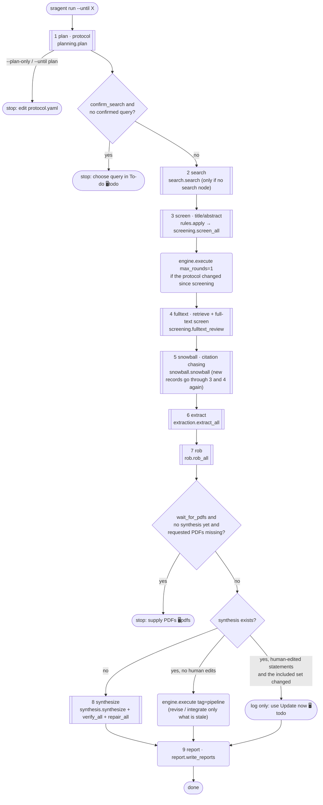

Facts worth keeping in mind

- `plan` runs on every `sragent run`: it re-validates terms and rewrites `protocol.yaml`
  ([planning.py:41-48](../../sragent/stages/planning.py#L41-L48)); `search` runs only once
  ([pipeline.py:17](../../sragent/pipeline.py#L17)) and cannot be redone without `--fresh`.
- The engine is called from inside the `screen` stage with `ctx.stage == "screen"`, so any extraction,
  RoB or synthesis item that happens to be stale at that moment is recomputed with the **screen** stage's
  model ([pipeline.py:24-30](../../sragent/pipeline.py#L24-L30), [context.py:22-24](../../sragent/context.py#L22-L24)).
- The search gate has no `human_mode` check; an agent-only run with `confirm_search: true` waits forever
  because the To-do card that confirms a query is hidden in agent-only mode ([pipeline.py:100-111](../../sragent/pipeline.py#L100-L111), [todos.py:77](../../sragent/todos.py#L77)).
- Where the UI starts this: Run page "Continue the review" (`/api/run action=run until=X`), Overview
  "Run to here", the Next-step banner. All three build the same job.

---

## 2. Stage 1 · Protocol (`plan`)

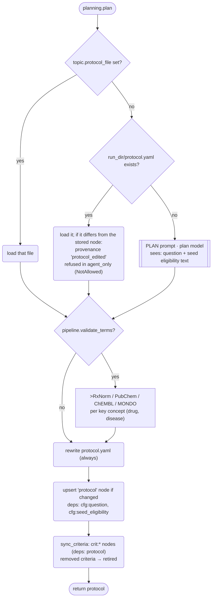

Human checkpoints around the protocol (four different code paths, see 02 and 03):

| Path | Where | Writes | Clears approval? | Logs revision? | Rule-only re-screen? |
|---|---|---|---|---|---|
| Approve | 🖥 todo "Yes, approve" → `todos.apply` | `meta.protocol_approved` | n/a | no | no |
| Edit criteria in place | 🖥 todo "Edit criteria" → `/api/protocol op=edit` → `planning.edit_criteria` → `apply_protocol` | protocol.yaml + nodes (actor user) | yes | yes | yes |
| Ask the agent | 🖥 todo "Ask" → `/api/protocol op=revise` → `planning.revise_protocol` (PLAN_REVISE, **in the HTTP thread**) → `apply_protocol` | protocol.yaml + nodes (actor **agent**) | yes | yes | yes |
| "I edited protocol.yaml, re-apply it" | 🖥 todo option `edited` → `todos.apply` | nodes (actor user) | **no** | **no** | yes |
| `sragent rescreen` | ⌨ | nodes (actor user) | no | no | yes |
| next `sragent run` | ⌨/🖥 run | nodes (actor **agent**, reason "protocol updated") | no | no | no; the engine re-assesses in stage 3 |

Nothing in `pipeline.run` waits for approval: approval is advisory
([pipeline.py:135-155](../../sragent/pipeline.py#L135-L155) never reads `protocol_approved`).

---

## 3. Stage 2 · Search

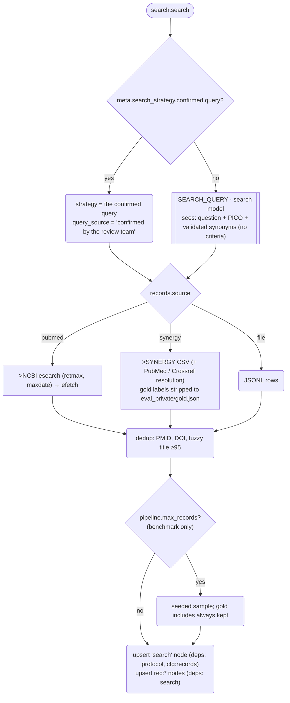

The strategy chosen with the team lives entirely in the UI and in `meta.search_strategy`
(🖥 todo "Search strategy" card → `/api/search_strategy op=suggest|refine|count|confirm|clear`):

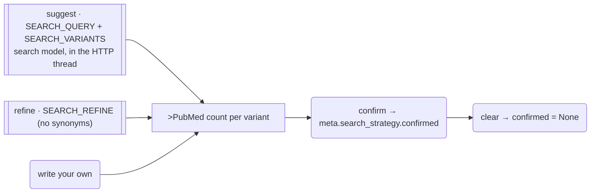

Refused once the `search` node exists ("a new query needs a fresh run folder"). No provenance record,
no `human_decisions.jsonl` line, no `human_mode` gate on any of these operations
([server.py:655-702](../../sragent/ui/server.py#L655-L702), [search.py:141-153](../../sragent/stages/search.py#L141-L153)).

---

## 4. Stage 3 · Title/abstract screening (`screen`)

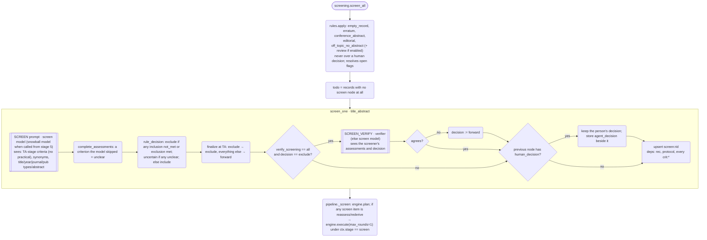

Re-screening paths that exist besides the pipeline (all write the same `screen:<rid>` node):

| Path | Function | Human decision | Model | UI |
|---|---|---|---|---|
| protocol changed → only the changed criteria re-assessed | `engine._screen` → `screening.reassess` | kept, disagreement flagged (`reassess` flag, never a to-do) | screen model via tag | 🖥 todo "Update now"; next run |
| rule-only re-derive (no LLM) | `screening.rescreen_rule_only` | skipped | – | 🖥 todo protocol paths; ⌨ `rescreen` |
| per-study re-run | `actions.rerun step=screen` (`keep_human=False`) | **replaced** in the proposal | job model or stage model | 🖥 study page |
| second reading of existing decisions | `screening.verify_existing` | skipped | verifier | ⌨ `verify-screening` only |
| feedback on a screen node | `feedback.apply_revised` | key kept but decision overwritten | feedback stage model | 🖥 study page / report comment |

---

## 5. Stage 4 · Full texts (`fulltext`: retrieval + full-text screening)

The pipeline entry is `screening.fulltext_review`; the retrieval code lives in `stages/fulltext.py`.

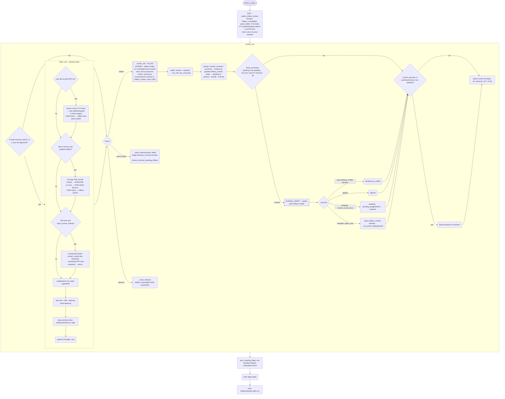

The eligibility decision as a state machine (one `screen:<rid>` node, field `stage` + `decision`):

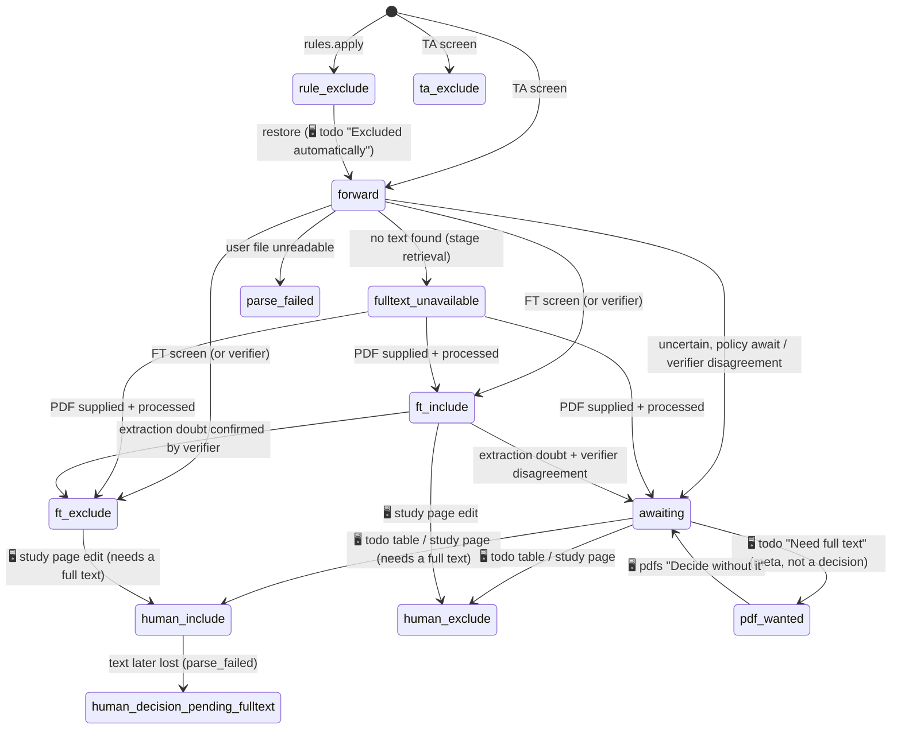

Human supply of PDFs (both modes):

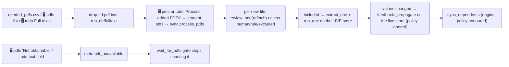

---

## 6. Stage 5 · Citation chasing (`snowball`)

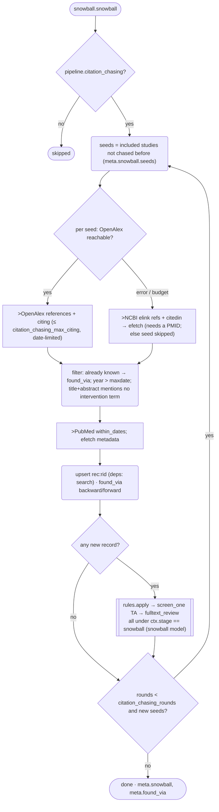

No UI exists for this stage beyond the "Up to stage" selector and the per-stage model row; it is not a
row of the Overview stepper ([steps.py:33-51](../../sragent/ui/steps.py#L33-L51)); `config_lock` counts it
as started the moment `meta.snowball` is created, even before it did anything
([config_lock.py:37](../../sragent/config_lock.py#L37), [snowball.py:34](../../sragent/stages/snowball.py#L34)).

---

## 7. Stage 6 · Data extraction (`extract`)

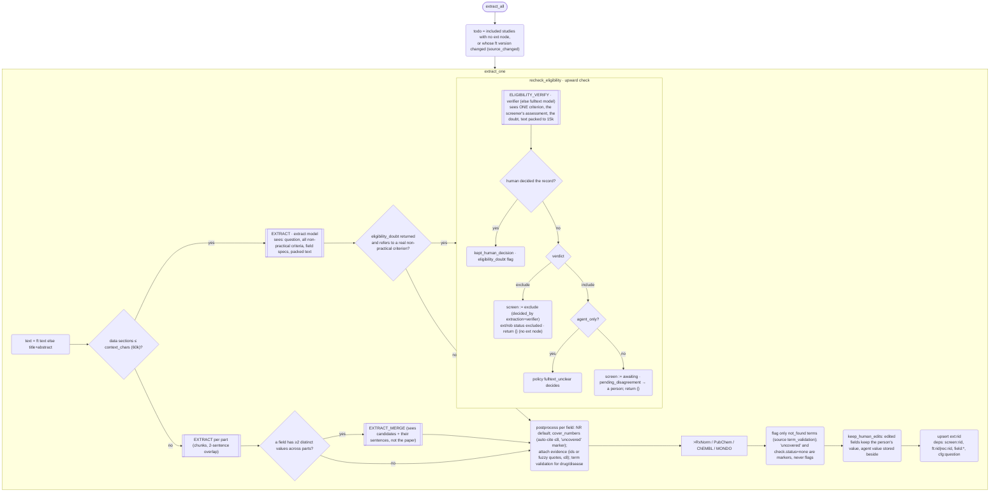

Five wrappers call `extract_one` with different pre/post logic: `extract_all` (pipeline),
`engine._extract` (fetches a missing full text first), `actions.rerun` (sandbox, note, cache off),
`feedback._include_study` (sandbox or live), `sync.process_pdfs` (live). Only `engine.plan` notices a
new extraction field or a re-included study; `extract_all` does not.

---

## 8. Stage 7 · Risk of bias (`rob`)

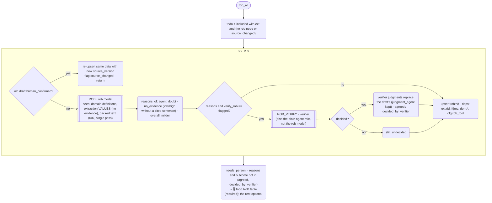

Other RoB paths: `reassess_all` (⌨ `reassess-rob`, 🖥 todo "Redraft all", cache off, confirmed kept),
`verify_existing` (⌨ `verify-rob` only), `actions.rerun step=rob` (🖥 study page; a confirmed draft
returns unchanged, so the proposal is always `no_change`), feedback on a rob node (🖥 todo "Ask the agent
to re-assess instead" → a *feedback* job, FEEDBACK_VERIFY prompt, verifier model).

---

## 9. Stage 8 · Synthesis (`synthesize`)

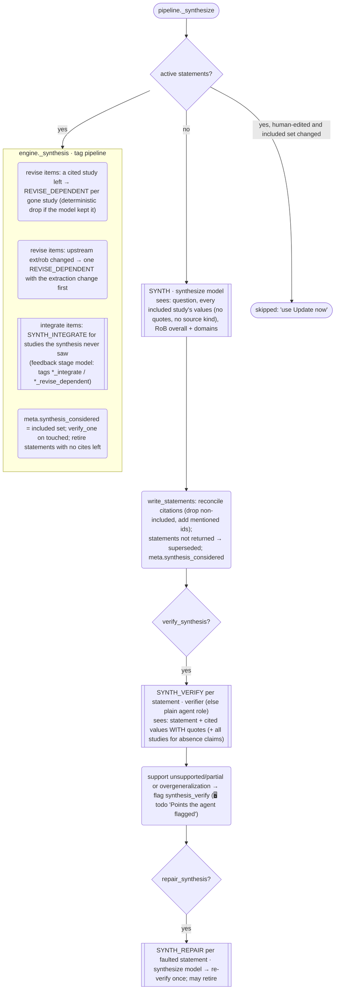

The synthesis is **never rewritten** once it exists (no UI or CLI path calls `synthesize()` again
except `--fresh`); all later change is statement-by-statement revision.

---

## 10. Stage 9 · Report

`report.write_reports` renders `report.md` and `report_evidence.html` from every node and several meta
keys (`snowball`, `rules_applied`, `config_lock`, `config_changes`, `synthesis_written_with`) and upserts
a `report` node that depends on the active statements. It is also rendered live by `GET /report`
(🖥 sidebar "Report", new tab). Re-rendered after: pipeline run, engine (when it changed something),
sync, manual edit, proposal accept. Not re-rendered after a To-do eligibility decision.

---

## 11. Cross-cutting flow A · the update engine (`engine.plan` / `engine.execute`)

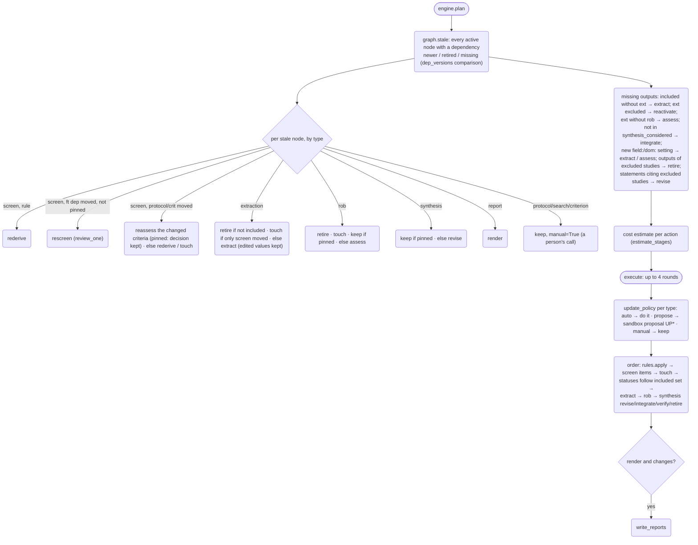

Who calls it, and how differently (details in 03):

| Entry | Trigger | Store | Policy | Rounds | Render | Model routing |
|---|---|---|---|---|---|---|
| pipeline `screen` | run | live | yes | 1 | no | **screen** stage model for everything |
| pipeline `synthesize` | run | live | yes | 4 | no (report stage) | by tag → feedback model |
| Update now | 🖥 todo / run tab → `sragent sync` | live | yes | 4 | yes | by tag |
| Process PDFs | 🖥 pdfs / todo → `sragent pdfs` | live, `_propagate` **policy=False** then sync | mixed | 2 + 4 | yes | by tag |
| feedback | 🖥 comment / flags → `sragent feedback` | sandbox → proposal | no | 2 | no | job model or feedback model |
| per-study re-run | 🖥 study → `sragent rerun` | sandbox → proposal | no | 2 | no | job model or stage model |
| propagate after edit | 🖥 todo "Your edits" → `sragent propagate` | sandbox → proposal | no | 2 | no | job model or feedback model |

---

## 12. Cross-cutting flow B · feedback (`feedback.handle_feedback`)

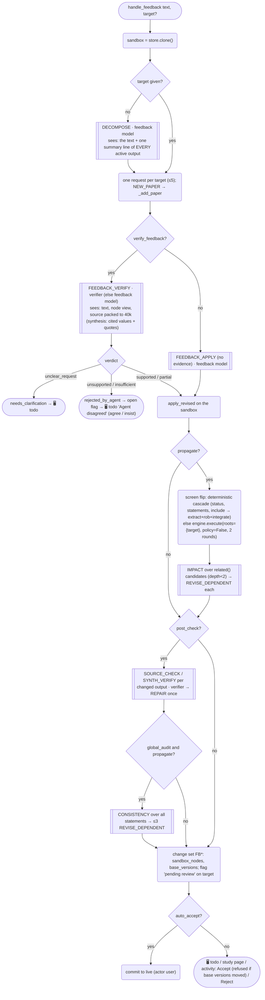

---

## 13. The dependency graph: declared vs written

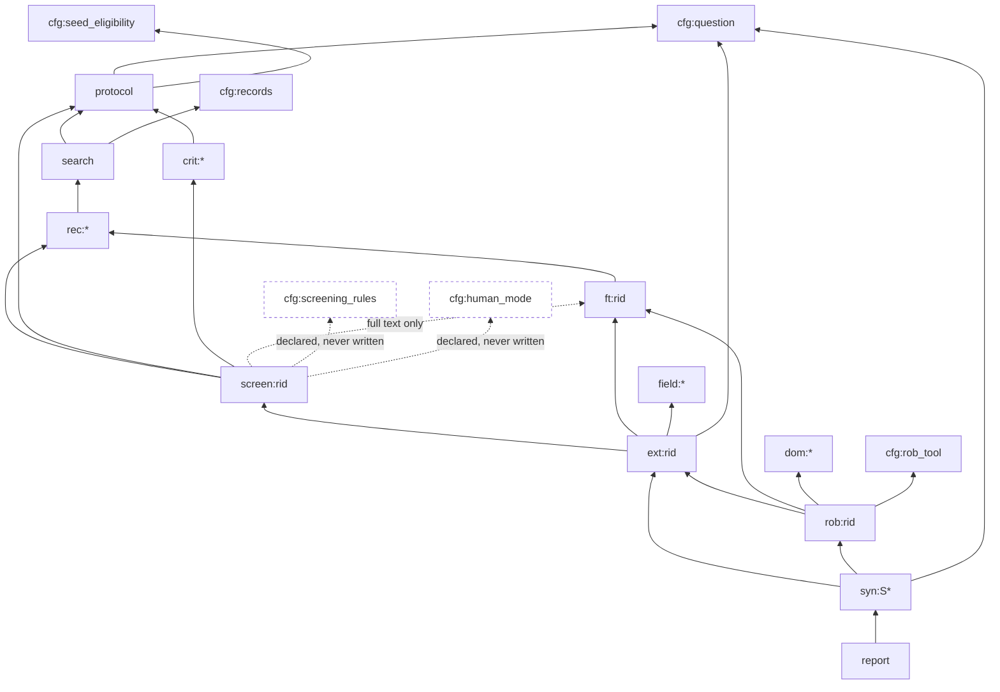

State that influences outputs or the UI but is **not** in the graph (so `graph.stale` cannot see it
change): `meta.search_strategy`, `meta.protocol_approved`, `meta.protocol_revisions`,
`meta.synthesis_considered`, `meta.synthesis_written_with`, `meta.snowball`, `meta.found_via`,
`meta.pdf_wanted`, `meta.pdf_unavailable`, `meta.waiting_for_pdfs`, `meta.rules_applied`,
`meta.rob_reassess`, `meta.config_lock`, `meta.config_changes`, `meta.comments`, `meta.snoozed`;
the files `protocol.yaml`, `feedback/*.json`, `needed_pdfs.csv`, `ui_settings.json`,
`human_decisions.jsonl`, `provenance.jsonl`; the run-time config values `pipeline.fulltext_unclear`,
`verify_screening`, `verify_rob`, `update_policy`, `stage_models` (locked by `config_lock`, but not
nodes). Flags are used as state machines for: awaiting, manual edit, pending proposal, agent
disagreement, re-assess disagreement, source changed ([graph-engine map §1.7](#)).

---

## 14. Entry points per operation, and whether the UI supports them

| Operation | pipeline run | 🖥 To-do | 🖥 Study page | 🖥 Run / Full texts / Overview | ⌨ CLI |
|---|---|---|---|---|---|
| Draft protocol | plan | – | – | Run "up to 1" | `run --plan-only` |
| Approve protocol | – | ✔ | – | – | – |
| Edit criteria / ask the agent | – | ✔ (two ops) | – | – | – (`rescreen` after a file edit) |
| Choose / confirm search query | – | ✔ (5 ops) | – | – | – |
| Run search / screening / full texts / … | ✔ | – | – | Run "up to N", Overview "Run to here" | `run --until` |
| Clear a stage and redo it | ✗ | ✗ | ✗ | ✗ | `run --fresh` (whole store) |
| Restore a rule exclusion | – | ✔ | – | – | – |
| Eligibility decision | – | ✔ table (include / exclude / need full text) | ✔ edit (include / exclude / awaiting) | – | – |
| Supply PDFs / not obtainable / decide without | – | ✔ (text field) | – | Full texts page (buttons) | files + `pdfs` |
| Process added PDFs | – | ✔ | – | Full texts, Run | `pdfs` |
| Re-run screening / extraction / RoB for one study | – | – | ✔ (with any model, note) | – | `rerun` |
| Redraft every RoB | – | ✔ button | – | – | `reassess-rob` |
| Verifier second look at existing decisions / drafts | – | – | – | – | `verify-screening`, `verify-rob` |
| Confirm / change RoB | – | ✔ table | ✔ edit | – | – |
| Edit extracted values / a statement | – | – | ✔ | – | – |
| Propagate a manual edit | – | ✔ ("Your edits") | – | – | `propagate` |
| Comment / send feedback | – | flags "fix" | ✔ | Studies list, Report page | `feedback` |
| Accept / reject a proposal | – | ✔ | ✔ | Activity | `accept`, `reject` |
| Update out-of-date outputs | synthesize stage | ✔ | – | Run "Update outputs" | `sync` |
| Change data items / domains | – | ✔ (card) | – | Configs editor (pauses the run) | file + `accept-config` |
| Change a stage's model | – | – | per-job pick | Run table (locked once started) | run file |
| Re-validate terms, fetch files, eval audit/summary | – | – | – | – | ⌨ only |
| Evaluation | – | – | – | Run (benchmark) | `eval` |

---

## 15. Hidden state a "clear this stage and re-run" would have to delete or reset

Legend for the last two columns: **resettable** = a function exists today that reverts it; **no function** = nothing in sragent/ can remove it (only hand edits or whole-store `--fresh`, which itself leaves every file listed in part D in place).

| stage | store nodes (type / prefix) | store.meta keys | flags (source) | files in run_dir | caches and locks | downstream dep_versions that would have to move | resettable today | no function |
|---|---|---|---|---|---|---|---|---|
| plan | `protocol` (+history), `crit:<id>` (retired ones kept, planning.py:76-79) | `protocol_approved` (set todos.py:423; popped only by apply_protocol planning.py:109), `protocol_revisions` (append-only 107/128), `config_lock.values["stage_models.plan"]` | `reassess` on screen nodes (screening.py:303-304) | `protocol.yaml` (rewritten every run 47-48, read back 23-25), `provenance.jsonl` human_judgment/protocol_edited | llm_cache: identical PLAN prompt -> cached draft; lock set at first save after protocol node (config_lock.py:105-113) | every `screen:*` records protocol + crit:* versions (screening.py:247-250); `search` records protocol (search.py:220); a new protocol version -> reassess of all screens via engine.plan (engine.py:85-91) | `protocol_approved` via apply_protocol only; criteria retire via sync_criteria | delete protocol/crit nodes; drop protocol_revisions; unlock stage model; delete protocol.yaml |
| search | `search`, `rec:<rid>` (deps ["search"]; snowball records identical, snowball.py:121) | `search_strategy` {variants, chat, confirmed, draft, suggested_at} (search.py:84-151; server.py:686, 694), `config_lock.values["stage_models.search"]` | none | `eval_private/gold.json` (gold.py:23-39, merged never cleared), `data/<key>_records.jsonl` | http_cache.sqlite caches esearch/efetch with no TTL (shared across runs); llm_cache SEARCH_QUERY; lock on search node | everything downstream (rec -> screen -> ft -> ext -> rob -> syn -> report) | `confirmed` only, before the search ran (`op=clear`) | delete search/rec nodes; clear variants/chat/draft; gold labels; cache entries |
| screen | `screen:<rid>` at title_abstract (rule-created actor rule, human-decided, verified) + history | `rules_applied` (rules.py:114, six writers), `snoozed` ids `elig:*`/`rule:*` (todos.py:417-419, never removed), `config_lock.values["stage_models.screen"]` | `screening`, `screening_unclear`, `reassess`, `eligibility_doubt` (on screen), `rerun` | `human_decisions.jsonl` (elig answers, append-only), `provenance.jsonl` elig:*/restore_rule_exclusion/decide_without_fulltext | llm_cache SCREEN + SCREEN_VERIFY per record; lock on any screen node | `ext:<rid>`/`rob:<rid>` depend on screen:<rid> (extraction.py:330; rob.py:55); synthesis cites; `_statuses` flips ext/rob active<->excluded (engine.py:352-361) | decisions re-derived without LLM by rescreen_rule_only (skips rule/human nodes, screening.py:558); rule exclusion undone by rules.restore; term flags only by revalidate | delete screen nodes; drop human_decision marks; un-snooze; unlock model |
| fulltext | `ft:<rid>` (text, local_file/auto refs), `screen:<rid>` at full_text/retrieval (title_abstract snapshot inside data, human_decision_pending_fulltext) | `pdf_wanted` (todos.py:451; popped 458/599/606, sync.py:23), `pdf_unavailable` (456/597, **never removed**), `waiting_for_pdfs` (pipeline.py:127; popped only by next run 120/124), `snoozed` "fulltexts", `config_lock.values["stage_models.fulltext"]` | `screening` (awaiting), `screening_unclear` | `fulltext/<rid>.pdf|.txt` (user), `fulltext/auto/<rid>.txt|.pdf` (fulltext.py:97-117), `fulltext/.parsed/*.json` (docparse.py:44), `fulltext/needed_pdfs.csv` (5 writers), `fulltext/README.txt`, `provenance.jsonl` pdf_provision/supplied (sha256 drives new_local_files 166-167, 273) and not_obtainable | http_cache Europe PMC/Unpaywall/OpenAlex incl. cached 404 None; llm_cache SCREEN(full_text), vision_page; lock on ft node or screen at full_text/retrieval (also set by engine/pdfs/feedback fetch_one) | screen (ft dep at FT), ext/rob (src_node + `source_version`, extraction.py:355-359), synthesis | re-fetch only for new-sha files via process_pdfs; pdf_wanted via "Decide without it"; waiting_for_pdfs by next run | delete ft nodes; undo pdf_unavailable; delete auto/.parsed files; forget provenance sha; unlock model |
| snowball | `rec:<rid>` with `found_via` (deps ["search"]), their `screen:*`/`ft:*`, screens with rule `outside_date_range` (+ ext/rob set excluded, rules.py:144-146) | `snowball` {seeds, added, rounds} (setdefault 34), `found_via` (35, 41-42, 122), `config_lock.values["stage_models.snowball"]` (locked at setdefault) | screening flags of added records | none of its own (http_cache OpenAlex/elink) | lock before any work (config_lock.py:37); llm_cache for its screenings (tags screen_*) | PRISMA counts (report.py:510-528 `reconciles` check); all outputs of added records | none | delete meta.snowball/found_via; delete added rec/screen/ft nodes (indistinguishable from search records in the graph); unlock model |
| extract | `ext:<rid>` (active/excluded; fields with `edited`, `agent_value`, `kept_human_edits`); `screen:<rid>` rewritten with `eligibility_review` (extraction.py:245-276) | `config_lock.values["stage_models.extract"]`, `snoozed` flag:/edited: ids | `term_validation`, `manual_edit` (on ext), `eligibility_doubt` (on screen), `rerun` | `feedback/RR*/UP*/FB*.json` targeting ext, `human_decisions.jsonl`, `provenance.jsonl` rerun_request:extract / propagate_request | llm_cache EXTRACT/EXTRACT_MERGE/ELIGIBILITY_VERIFY; lock on any extraction node (also from sync/engine) | `rob:<rid>` (ext dep), `syn:*` via statement_deps (synthesis.py:14-20), `report` | term flags via revalidate_terms (398); status via engine._statuses; edited fields survive re-extraction by design (keep_human_edits 343-352) | delete ext nodes; drop edited marks; unlock model; reject/purge proposals |
| rob | `rob:<rid>` (`human_confirmed`, `rob_verify`, `judgment_agent`) | `rob_reassess` {started, rids, done} (rob.py:208; popped 221 only on completion), `config_lock.values["stage_models.rob"]` | `source_changed`, `manual_edit`, `rerun` | feedback cs files, `human_decisions.jsonl` (rob confirm/change), `provenance.jsonl` rob:* | llm_cache ROB/ROB_VERIFY; lock on any rob node | `syn:*` (rob deps), `report` | re-draft all via reassess_all (cache off, keeps confirmed); re-verify not possible (verify_existing skips rob_verify) | un-confirm a draft (human_confirmed only ever set); delete rob nodes; clear a stuck rob_reassess; unlock model |
| synthesize | `syn:S<k>` active / `superseded` (synthesis.py:111) / `retired` (43-53); `data.verification` written in place without version (154); `repaired_from`; `edited` | `synthesis_considered` (112; engine.py:432 on every _synthesis incl. sandbox -> copied on accept), `synthesis_written_with` (113-114), `waiting_for_pdfs`, `snoozed` "sync", `config_lock.values["stage_models.synthesize"]` | `synthesis_verify`, `update`, `feedback`, `manual_edit` | `feedback/UP*.json` (update proposals), `report.md`/`report_evidence.html` | llm_cache SYNTH/SYNTH_VERIFY/SYNTH_REPAIR/SYNTH_INTEGRATE/REVISE_DEPENDENT; lock on any synthesis node | `report` (deps = active syn ids, report.py:930-931) | statements superseded only by writing a new synthesis in synthesize() (never callable once one exists); per-statement revise via engine/feedback | delete/supersede all statements; reset synthesis_considered/written_with; unlock model |
| report | `report` (prisma, chars; same data -> touch) | none | none | `report.md`, `report_evidence.html` (overwritten per write_reports) | none (no LLM); `configs.run_status` reads report.md existence (configs.py:28-37) | none | re-render on next write path | delete files/node (so a fresh folder stops showing "review done") |
| verifier | fields inside other nodes: `screen.screen_verify`, `screen.eligibility_review`, `rob.rob_verify`, `syn.verification` (in place, no version) | none (roles.verifier never locked) | `screening` pending_disagreement, `eligibility_doubt`, `synthesis_verify` | none of its own; cost in usage.jsonl tagged screen_verify_*/eligibility_verify/rob_verify/synthesis_verify | llm_cache per verify prompt (rerun does not bypass it, S206) | the decisions it changed (decided_by verifier) | none; verify_existing skips already-verified nodes | remove a verification; re-verify |
| feedback / update | sandbox results committed via put_node/upsert (actor user, reason "accepted feedback <id>") | `comments` [C<n>] (actions.py:36-52), `snoozed`, `flag_seq`, `config_lock` {recorded, values}, `config_changes` [], `schema` | `feedback` ("-> agent:" disagreement), `rerun`, `update`, `manual_edit`, `source_changed` | `feedback/<FB|RR|UP>.json` (statuses proposed/accepted/rejected_*/stale/no_change/needs_clarification/withdrawn; never deleted; `proposed` ones re-listed by todos.build 286-321), `ui_jobs/jobs.jsonl` + `<id>.log` (append-only), `ui_job_config.yaml` (overwritten per job), `ui_settings.json` (last Run-page model -> job_agent for later jobs, server.py:317-318, 842-844), `human_decisions.jsonl` (two lines per queued answer), `provenance.jsonl`, `usage.jsonl` (cumulative budget, llm.py:72-81), `cost.json`, `run.log`, `store_changelog.jsonl` (rewritten by a fresh store's first save, store.py:234-240), `store.json.bak` | `.cache/llm_cache.sqlite` and `.cache/http_cache.sqlite` shared by every run folder (context.py:54; llm.py:500); no command clears either | n/a | proposals rejected one by one (`feedback.reject`); comments resolved | purge proposals/jobs/settings; truncate usage.jsonl; clear caches; drop a stage's lock |

---

## 16. What `sragent run --fresh`, the only reset that exists, actually does

| item | after `--fresh` |
|---|---|
| store.json nodes + meta | replaced by an empty store on first save (old copy in store.json.bak) |
| store_changelog.jsonl | **overwritten** (fresh store `_flushed=0` -> rewrite branch, store.py:239): history lost |
| cfg:*/field:*/dom:* setting nodes | **not created during that run** when store.json existed (context.py:66-67) -> outputs lack dep_versions for settings (store.py:122; graph.py:125) |
| protocol.yaml | kept and **reloaded** by plan() (planning.py:23-25): no new draft, no provenance |
| config_lock | empty meta -> no check; first save re-records current cfg and locks each stage as its first output appears |
| usage.jsonl / budget | kept; CostTracker starts with the old spend (llm.py:72-81); CLI run may raise BudgetExceeded immediately; UI masks it (server.py:344-345) |
| llm_cache.sqlite / http_cache.sqlite | kept and read: identical prompts return the old answers (llm.py:266-270); no `--no-cache` for run |
| fulltext/*.pdf, auto/, .parsed/, needed_pdfs.csv, README.txt | kept; user PDFs re-parsed from provenance sha (fulltext.py:165-167) |
| provenance.jsonl, human_decisions.jsonl, ui_jobs/, ui_settings.json, ui_job_config.yaml | kept (append-only or overwritten per job) |
| feedback/*.json | kept; `proposed` sets reappear as `cs:` to-dos; accept -> StaleProposal (todos.py:548-552) |
| report.md / report_evidence.html | kept; Configs page `run_status` says "review done" until the next render (configs.py:28-37) |
| eval_private/gold.json, eval/ | kept |
