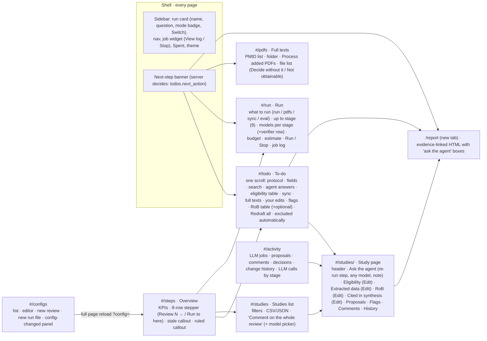
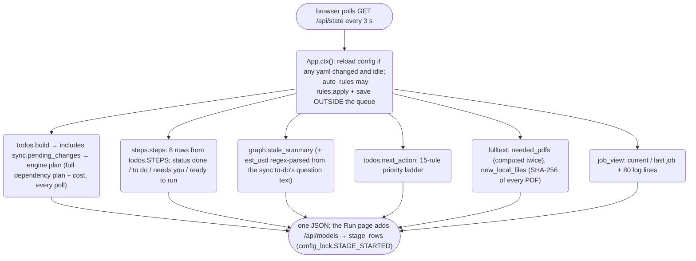
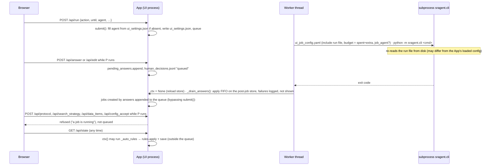

# 02 · The web UI as it is today (routes, actions, what is and is not aligned)

Source: `sragent/ui/static/index.html` (2,169 lines, one file), `sragent/ui/server.py`,
`sragent/ui/steps.py`, `sragent/ui/configs.py`, and the screenshots in `docs/`. Line references
`ui:N` mean `sragent/ui/static/index.html:N`.

---

## 1. Map of the interface

Two routing mechanisms coexist: the run file is a query parameter (`?config=`, full reload when
switching) and the view is a hash (`#/todo`). The sidebar links bypass `route()` and therefore bypass the
unsaved-config guard (ui:539, ui:557-560).

---

## 2. What the server computes for one screen (three "where are we" calculations)

Three independent status computations feed one screen and can disagree: `steps.py` (done/needs you),
`todos.next_action` (what to do next), `graph.stale` + `engine.plan` (what is out of date). A fourth,
`config_lock.STAGE_STARTED`, decides "fixed" on the Run page; a fifth, `configs.run_status`, labels the
Configs list.

---

## 3. Stage × control matrix (what a person can do to each stage, and where)

| Stage | Name on Overview | Name on Run page | Run to here | Run only this | Re-run one study | Re-run all (fresh) | Clear stage | Its to-dos | Its outputs | Model | Cost | Depends on | Depended on by |
|---|---|---|---|---|---|---|---|---|---|---|---|---|---|
| plan | Protocol | Protocol | ✔ | ✗ | n/a | "Ask the agent" (one call, not a re-run) | ✗ | todo protocol card | todo criteria table | Run row (locked) | estimate | ✗ | prose only |
| search | Search | Search | ✔ | ✗ | n/a | ✗ ("new run folder") | ✗ | todo search card | todo "ran" card | Run row | estimate | ✗ | ✗ |
| screen | Screening | Title/abstract screening | ✔ (runs to **fulltext**) | ✗ | study page | ✗ | ✗ | todo eligibility table | study page, studies list | Run row | estimate, study est. | ✗ | impact line on study-page edit only |
| fulltext | Full texts | Full-text screening | ✔ | "Process added PDFs" (incremental) | ✗ (no fulltext step in the re-run seg) | ✗ | ✗ | todo Full texts, #/pdfs | study header "source used" | Run row | estimate (Run only) | ✗ | ✗ |
| snowball | **absent** | Citation chasing | ✔ | ✗ | ✗ | ✗ | ✗ | none | none | Run row | estimate | ✗ | ✗ |
| extract | Data extraction | Data extraction | ✔ | ✗ | study page | ✗ (sync covers new studies only) | ✗ | todo fields card, "Your edits" | study page (Edit values) | Run row | estimate, impact | ✗ | impact line only |
| rob | Risk of bias | Risk of bias | ✔ | "Redraft all" | study page; todo "Ask to re-assess" | "Redraft all" | ✗ | todo RoB tables | study page (Edit domains) | Run row | confirm dialog | ✗ | impact line only |
| synthesize | Synthesis | Synthesis | ✔ | ✗ | ✗ | ✗ | ✗ | todo sync card, flags | study page "Cited in", report | Run row | estimate, stale callout | stale callout (after the fact) | ✗ |
| report | Report | (no row) | ✔ | ✗ | ✗ | re-rendered on every write | ✗ | none | sidebar link | ✗ | ✗ | ✗ | n/a |
| verifier (role) | – | "Checks (verifier)" row | – | – | – | – | – | – | – | Run row | estimate rows | – | – |
| feedback (pseudo-stage) | "Feedback & revisions" | "Feedback, revisions and updates" | – | – | – | – | – | agent answers | Activity proposals | Run row | – | – | – |

No stage has a page. "Clear this stage" exists for nothing. "Run only this stage" exists for nothing.
"Stop" is global. "What depends on this" is shown only as the impact line while editing on the study
page, and only after the person has already opened the editor.

---

## 4. The same action from several places (and whether they do the same thing)

| # | Action | Place A | Place B / C | Same endpoint | Same effect |
|---|---|---|---|---|---|
| 1 | Eligibility decision | To-do table → `/api/bulk eligibility` (include / exclude / **pdf**) | Study page → `/api/edit screen` (include / exclude / **awaiting**) | no | no: different flags resolved, different decision-log ids, only B re-renders the report, only B shows impact |
| 2 | RoB confirm / change | To-do "Confirm selected" → `/api/bulk rob_confirm`; "Save changes and confirm" → `/api/answer rob:change` | Study page "Save and confirm" → `/api/edit rob` | no (3 endpoints) | no: to-do "change" with the `changes` list calls `actions.edit` and logs the decision twice; legacy single-domain change sets no `manual_edit` flag; study page also edits rationale |
| 3 | Ask the agent to re-assess RoB | To-do "Ask the agent to re-assess instead" → **feedback job** (FEEDBACK_VERIFY on the rob node, verifier model) | Study page "Re-run" step rob → **rerun job** (ROB prompt, chosen model); To-do "Redraft all" → `reassess_rob` job | no (3) | no: three different prompts and models for "do the RoB again" |
| 4 | Process added PDFs | To-do group / Full texts page → `/api/run pdfs` (no estimate, model from `runOpts.agent` or settings) | Run page optcard → `/api/run pdfs` (saves dirty stage models first, shows estimate) | yes | payload differs |
| 5 | Update out-of-date outputs | To-do "Update now" → `/api/answer sync` | Run "Update outputs after my decisions" → `/api/run sync` | no | same job; different logging (`human_decisions.jsonl` only on A) |
| 6 | Accept / reject a proposal | To-do card (radio + Submit, with a note) | Study page / Activity (two buttons, no note) | yes | yes |
| 7 | Send a comment to the agent | Studies list (model picker `ST.agent`) | Study page (model `ST.rr.agent` from the re-run picker); Report page boxes | yes | model chosen by two different pickers; job submitted before the comment is saved |
| 8 | Change the protocol | To-do card (edit in place / ask) → `/api/protocol` | Configs editor `topic.yaml` → pauses the run until accepted | no | no |
| 9 | Change data items / domains | To-do fields card → `/api/data_items` (auto-accepts the locked change) | Configs editor → pauses the run | no | no |
| 10 | Choose a model | Run per-stage table (run file) | Study-page re-run picker; Studies-list comment picker; eval "Agent model"; New-review form; Configs editor; `processPdfs` with no picker | no (6) | the last Run-page choice silently becomes the model of every later feedback / re-run / propagate job that names none |
| 11 | Jobs and logs | Run page (current / last) | Activity (all); sidebar widget | different sources | – |
| 12 | Spent so far | Sidebar; Overview KPI; Run "already spent"; Activity usage; Configs list | – | four sources | – |
| 13 | Config changed | Configs badge; changed panel; editor lock note; save message; check badge; sidebar card | – | five renderings | – |

---

## 5. Jobs and queued answers (how writes are serialized, and where they are not)

Two different "busy" predicates: `job is not None` (answers, edits, protocol, search) versus
`idle()` = no job, empty queue, no pending answers (reload, data items, accept config, stage models).
Three operations call the LLM in the HTTP thread (protocol revise, search suggest, search refine) and
one on every "Test model" click.

---

## 6. Mode and kind gating

- **Agent-only** hides: every "Edit" and "Ask the agent" control on the study page, the review-comment
  "Send", the RoB "Ask to re-assess" and "Redraft all", the protocol card once approved. The To-do list
  keeps only "Full texts". Not hidden (the server refuses them): eligibility Save, RoB confirm, protocol
  edit, search confirm, fields save, Update now, restore, accept/reject.
- **Benchmark** shows: the Evaluation optcard, "Max records to screen", judge model, suite picker.
- The Run page hides the "Agent model" selector for run/pdfs/sync jobs (the per-stage table replaces
  it) but still sends `agent` in the payload, which is then stored in `ui_settings.json` and reused.

---

## 7. Naming of the same things in different places

| Concept | Overview | Run page | To-do | Sidebar / titles | Keys | CLI / GUIDE |
|---|---|---|---|---|---|---|
| stage 3 | Screening | Title/abstract screening | 3. Screening (also hosts eligibility, which is full-text) | – | `screen` | screen |
| stage 4 | Full texts | Full-text screening | 4. Full texts | Full texts / PDFs (`#/pdfs`) | `fulltext` / job `pdfs` | fulltext / pdfs |
| stage 5 | (absent) | Citation chasing | (absent) | – | `snowball` | snowball |
| stage 8 | Synthesis | Synthesis | 7. Synthesis (`data-step="synthesis"`) | – | `synthesize` | synthesize |
| undecided record | "undecided" / "pending" | – | "Need full text" / awaiting | "waiting for your PDF" / "missing" | `awaiting`, `pdf_wanted`, `fulltext_unavailable`, `parse_failed`, `forward` | awaiting classification |
| agent invocation verb | – | Run | Ask · Suggest again · Send to the agent · Ask the agent to re-assess instead · Redraft all · Update now · Process added PDFs · Re-run | – | – | – |
| save verb | – | Save to run file | Save criteria (no LLM) · Save N decisions · Save changes and confirm · Confirm selected · Confirm this query | – | – | – |

---

## 8. Things the screenshots make visible

- `docs/ui_steps.png`: the stepper says "7 of 8 steps done" for a review with nine pipeline stages;
  "Run to here" only appears on hover.
- `docs/ui_run.png`: every stage row says "fixed: stage started" in a finished review; the verifier is a
  row of the same table although it is a role; the Agent model picker is hidden yet still submitted.
- `docs/ui_todo_rob.png`: one screen holds 14 RoB rows with a Change button each, while the same edit
  exists on each study page with a different form.
- `docs/ui_study_page.png`: the study page is the only place that shows an impact preview, and only
  after "Edit" is pressed.
- `docs/ui_fulltexts.png`: the Full texts page is effectively a stage page for retrieval; it is the only
  stage that has one.

---

## 9. Appendix · every name of every stage and role (as found in the code)

| concept | pipeline.REGISTRY key / label (pipeline.py:81-91) | config.LLM_STAGES / STAGE_LABELS (config.py:267-270) | config_lock.STAGE_STARTED (config_lock.py:31-41) | todos.STEPS (todos.py:26-30) | ui/steps.py key / run_until (steps.py:32-51) | engine actions (STAGE_FOR / ORDER, engine.py:29-32; plan actions 81-160) | node type / id prefix (store.py:5-12, graph.py:34-47) | LLM tag prefix (config.py:279-281; grep tag=) | UI sidebar / page / card titles (index.html) | CLI subcommand (cli.py:286-412) | GUIDE.md / README name |
|---|---|---|---|---|---|---|---|---|---|---|---|
| Protocol drafting | `plan` / "Protocol" | `plan` / "Protocol" | `plan`: protocol node exists | `plan` / "1. Protocol" | `plan` / `plan` | none (ORDER has no plan; STAGE_FOR none; plan item `keep` manual for protocol/search) | `protocol` (id `protocol`), `criterion` (`crit:<id>`) | `plan`, `plan_revise` | Overview row "Protocol"; To-do group "Protocol" (kind/id `protocol`); Run select "1. Protocol"; Models row "Protocol"; job label "Run review up to plan" | `run --until plan`, `run --plan-only`, `rescreen` (re-applies protocol.yaml) | "[1] PLAN" (GUIDE:203); README `plan` |
| Search | `search` / "Search" | `search` / "Search" | `search`: search node | `search` / "2. Search" | `search` / `search` | none | `search` (id `search`), `record` (`rec:<rid>`) | `search`, `search_variants`, `search_refine` | Overview "Search"; To-do "Search strategy" (kind `search`, meta `search_strategy`); Run select "2. Search"; Models "Search" | `run --until search` | "[2] SEARCH"; README `search` |
| Title/abstract screening | `screen` / "Title/abstract screening" | `screen` / "Title/abstract screening" | `screen`: any screen node (incl. full-text ones) | `screen` / "3. Screening" (covers TA + FT) | `screen` / **`fulltext`**; done = no TA node left non-exclude | ORDER `rules`,`screen`,`status`; STAGE_FOR `reassess`->screen; actions `reassess`, `rederive`, `touch`, `rules` | `screen` (`screen:<rid>`, data.stage ∈ title_abstract / full_text / retrieval) | `screen_title_abstract[_rerun|_feedback]`, `screen_verify_title_abstract` (-> "feedback" in stage_of_tag) | Overview "Screening"; To-do group "Eligibility" (kind `eligibility`, id `elig:<rid>`, step `screen`), "Excluded automatically" (ruled); Study page section "Eligibility", re-run step "Screening (eligibility)"; Run select "3. Title/abstract screening"; estimate row `screen_title_abstract` | `run --until screen`, `rescreen` (no-LLM rederive), `verify-screening --mode all` | "[3] SCREEN"; README `screen` |
| Full-text retrieval + screening | `fulltext` / "Full texts + full-text screening" | `fulltext` / "Full-text screening" | `fulltext`: any fulltext node, or screen node at full_text/retrieval | `fulltext` / "4. Full texts" | `fulltext` / `fulltext`; done = any ft node | STAGE_FOR `rescreen`->fulltext; action `rescreen` (LLM review_one); graph.TYPES fulltext update "recompute" (no engine branch) | `fulltext` (`ft:<rid>`, data.kind fulltext/abstract); decisions `fulltext_unavailable`, `parse_failed` | `screen_full_text[_rerun|_feedback]`, `screen_verify_full_text`, `vision_page` | Sidebar "Full texts" -> `#/pdfs` (VIEWS `pdfs`, TITLES "Full texts / PDFs that would help the agent"); To-do group "Full texts" (kind/id `fulltexts`, step `fulltext`); Run card "Process added PDFs" (job `pdfs`); Run select "4. Full texts + full-text screening"; Models "Full-text screening"; state `S.fulltext`; next-step go `pdfs` -> "Open Full texts"; estimate `screen_full_text`, `screen_verify` | `run --until fulltext`, `pdfs [--list]`, `fetch-files`, `verify-screening --mode pending|full_text` | "[3b] FULL TEXT", "7.2 Full texts"; README `fulltext` |
| Citation chasing | `snowball` / "Citation chasing" | `snowball` / "Citation chasing" | `snowball`: meta.snowball exists | absent | absent (Overview has 8 rows, Run select 9) | none | none (new `rec:<rid>`; meta `found_via` = "citation") | none of its own (screen_* tags under ctx.stage snowball) | Run select "5. Citation chasing"; Models "Citation chasing"; no Overview row | `run --until snowball`; config `pipeline.citation_chasing*`, `skip_stages: [snowball]` | "[3c] CITATION CHASING"; README `snowball` |
| Data extraction | `extract` / "Data extraction" | `extract` / "Data extraction" | `extract`: extraction nodes | `extract` / "5. Data extraction" | `extract` / `extract` | ORDER `extraction`; STAGE_FOR `extract`->extract; actions `extract`, `reactivate`, `retire`, `touch` | `extraction` (`ext:<rid>`); update_policy key `extraction`; settings `field:<name>` | `extract`, `extract_merge`, `eligibility_verify` (-> feedback) | Overview "Data extraction"; To-do "Data items and quality domains" (kind `fields`, step extract); Study page "Extracted data", re-run "Data extraction"; Run select "6. Data extraction" | `run --until extract`, `rerun --step extract`, `revalidate-terms` | "[4] EXTRACT"; README `extract` |
| Risk of bias | `rob` / "Risk of bias" | `rob` / "Risk of bias" | `rob`: rob nodes | `rob` / "6. Risk of bias" | `rob` / `rob` | ORDER `rob`; STAGE_FOR `assess`->rob; actions `assess`, `retire`, `keep`, `touch` | `rob` (`rob:<rid>`); settings `dom:<name>` | `rob`, `rob_verify` | Overview "Risk of bias"; To-do group "Risk of bias" (kind `rob`, id `rob:<rid>`), button "Redraft all risk-of-bias assessments" (job `reassess_rob`, label "Redraft every risk-of-bias assessment"); Studies column "RoB"; Study page "Risk of bias"; Run select "7. Risk of bias" | `run --until rob`, `rerun --step rob`, `reassess-rob`, `verify-rob` | "[5] RoB"; README `rob` ("quality judgments") |
| Synthesis | `synthesize` / "Synthesis" | `synthesize` / "Synthesis" | `synthesize`: synthesis nodes | **`synthesis`** / "7. Synthesis" | **`synthesis`** / run_until `synthesize` | ORDER `synthesis`, `integrate`; STAGE_FOR `revise`->feedback, `integrate`->feedback; actions `revise`, `integrate`, `keep` | `synthesis` (`syn:S<k>`, pseudo `syn:+<rid>`); update_policy key `synthesis`; STEP_OF_TYPE synthesis->synthesis; statuses active/superseded/retired | `synthesis`, `synthesis_verify`, `synthesis_repair`, `synthesis_verify_repair` | Overview "Synthesis"; To-do group "Out-of-date outputs" (kind `sync`, step `synthesis`); Study page "Synthesis"; Run select "8. Synthesis"; estimate rows synthesis/synthesis_verify/synthesis_repair -> stage synthesize | `run --until synthesize`, `sync` | "[6] SYNTHESIS"; README `synthesize` |
| Report | `report` / "Report (whole review)" (llm False) | none (stage_models.report rejected) | none | none | none | ORDER `report`; action `render` | `report` (id `report`) | none | Sidebar "Report" (external `/report`, section "Output"); Run select "9. Report (whole review)"; next-step "Open report" | `run --until report` (default) | "[7] REPORT"; README `report` |
| Feedback / revisions (model bucket, not a stage) | none | `feedback` / "Feedback, revisions and updates" | none (never locked) | `feedback` / "8. Feedback & revisions" (always done) | `feedback` / None; done always True | STAGE_FOR `revise`,`integrate` -> feedback | none; proposal files `feedback/<FB|RR|UP>.json` | every tag without a known prefix: `feedback_*`, `{tp}_locate|verify|apply|impact|audit|check|repair|integrate|revise_dependent`, `sync`, `pipeline`, `screen_verify_*`, `eligibility_verify`, `vision_page`, `ui_test_model` | Overview row "Feedback & revisions"; To-do jump "Agent answers" / heading "The agent's answers to your feedback" (kinds `changeset`, `clarify`, `disagreement`); Models row "Feedback, revisions and updates"; Activity "Agent proposals"; Study page "Ask the agent", "Proposals", "Comments" | `feedback`, `rerun`, `propagate`, `accept`, `reject` | "FEEDBACK" (diagram), "7.4 Feedback examples"; config section `feedback` |
| Verifier (model role) | none | none (role, not in LLM_STAGES) | none | none | none | none | none | `screen_verify_<stage>`, `rob_verify`, `synthesis_verify`, `eligibility_verify`, `{tp}_verify`, `{tp}_check` (all billed as "feedback") | Models row "Checks (verifier)" with stage key `verifier` (server.py:751); copy "self-check", "the verifier", "two agents", "neither agent"; Studies "(verifier)", "(extraction + verifier)"; steps "flagged by the self-check"; report FLAG_KIND "self-check" | `verify-screening` ("second reading"), `verify-rob` ("second look"); config `roles.verifier`, `pipeline.verify_screening|verify_rob|verify_synthesis`, `feedback.verify_feedback` | "the verifier", "self-check", "second reading/look", "the checker"; eval roles `judge`, `judge2`, `reviewer` |

Other stage-like vocabularies: `estimate.DEFAULTS` rows (plan, search, screen_title_abstract, screen_full_text, screen_verify, extract, rob, rob_verify, synthesis, synthesis_verify, synthesis_repair, feedback) with `ROW_STAGE` (estimate.py:17-34); `update_policy` keys screen/extraction/rob/synthesis (config.py:119); `ui/server.STAGE_JOBS` run/pdfs/sync/reassess_rob (server.py:32) vs `index.html STAGE_JOB` run/pdfs/sync (1265); `cli --until` = REGISTRY keys (cli.py:296).

---

## 10. Appendix · the update / redo verb family

| word | code meaning(s) | user-facing wording |
|---|---|---|
| sync | CLI `sync`; job `sync`; to-do kind/id `sync`; tag `sync`; sync.py (sync_dependents, process_pdfs, pending_changes, dead update_synthesis); graph.sync_settings; planning.sync_criteria; screening.sync_awaiting_flags; STAGE_JOBS | "Update now" (to-do), "Update outputs after my decisions" (Run), "Update outputs after decisions" (job), "Out-of-date outputs" (group), "See the plan and update" (Overview); GUIDE "Decisions stay in sync"; README "sync: update extraction/RoB/synthesis after human decisions" |
| update | "update engine" (engine.py); graph.TYPES update verbs (settings, derive, assess, rederive, recompute, revise, render); `update_policy`; proposal kind `propagate` id prefix UP label "Update after your edit"; flag source `update`; engine verdict "update"; to-do option `update` (manual_edit -> propagate job); job label "Update outputs after your edit of X" | "Update now" (= sync), "Yes, propose updates" (= propagate), "Updating costs about $" |
| propagate | CLI `propagate`; job `propagate`; actions.propagate_from; feedback._propagate (feedback, rerun, pdfs, propagate); config `feedback.propagate`; `rerun --no-propagate`; pipeline docstring "later PDFs propagate" | never shown: "Also propose updates to the outputs that depend on it", "Update after your edit" |
| revise | engine action `revise` (synthesis); graph verb; feedback._revise_dependent; tags plan_revise, {tp}_revise_dependent; STAGE_LABELS "Feedback, revisions and updates"; STEPS "Feedback & revisions" | "revises only the affected synthesis statements", "Ask the agent to revise it" |
| integrate | engine action `integrate` (syn:+rid); feedback._include_study(integrate=True); tag {tp}_integrate; ORDER `integrate` | "Included but not yet considered in the synthesis" |
| rerun / re-run | CLI `rerun --step`; job `rerun`; RR proposal kind `rerun`; flag source `rerun`; tag suffix `_rerun`; actions.rerun; RERUN_STEPS | "Re-run this step", "Re-run", "Re-run of data extraction", "Re-run Screening (eligibility) for <rid>"; Overview "Run to here"; Run card "Continue the review"; job "Run review up to <key>" |
| reassess / re-assess | engine action `reassess` (screen on changed criteria, LLM); screening.reassess; flag source `reassess` (= "protocol changed"); rob.reassess_all; CLI `reassess-rob`; job `reassess_rob`; meta `rob_reassess` | sync hint "Re-assesses screening on the changed criteria only"; "Redraft all risk-of-bias assessments" / "Redraft every risk-of-bias assessment"; GUIDE 6.1 "re-assessing the criteria that changed", "assessing again" (rob) |
| rescreen / re-screen | CLI `rescreen` = screening.rescreen_rule_only (no LLM); engine action `rescreen` = screening.review_one (LLM, ft moved); sync.process_pdfs result "rescreened" (LLM) | CLI help "re-derive eligibility decisions ... (no LLM calls)"; to-do "Ask the agent to screen it again"; GUIDE "sragent rescreen" |
| rederive / re-derive | engine action `rederive`; graph verb; screening.rederive; reasons "eligibility re-derived", "decision re-derived" | CLI `rescreen` help; GUIDE 7.3 |
| recompute | graph.TYPES verb for fulltext/extraction/rob (engine uses extract / assess / reactivate instead) | -- |
| assess | engine action `assess` (rob); per-criterion "assessment" (met/not_met/unclear); "assessments" = RoB drafts | "extracts and assesses", "Redraft ... assessments" |
| redraft | UI / job label for reassess_rob only | "Redraft all risk-of-bias assessments" |
| refresh | UI buttons only (35 uses) | "Refresh" |

Counts (grep, word + s/d/ed/ing): sync py36/html11/md5; update py124/html11/md37; propagate py56/html7/md11; revise py94/html4/md20; integrate py15/html0/md3; rerun+re-run py36/html7/md20; reassess+re-assess py26/html3/md7; rescreen+re-screen py16/html0/md7; rederive+re-derive py22/html0/md4; recompute py7/html0/md0; redraft py4/html3/md1.
