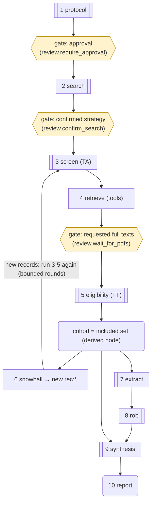
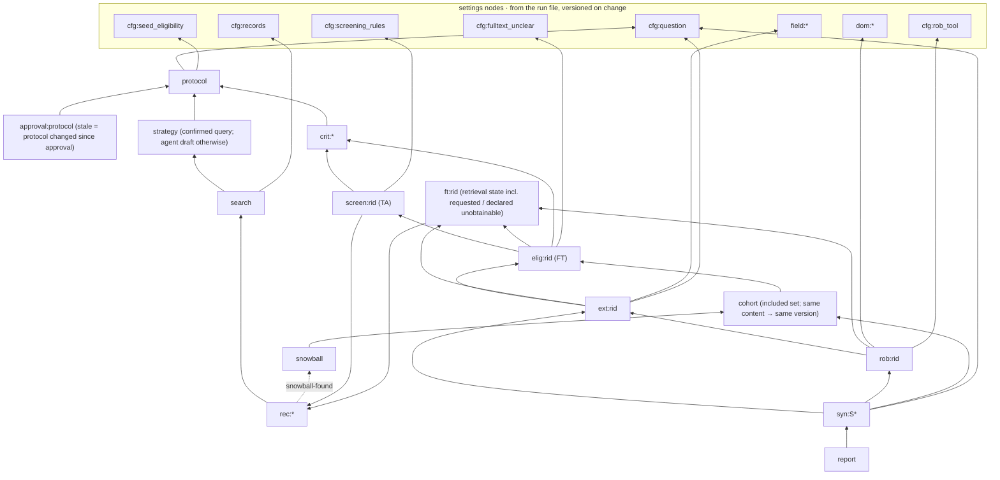
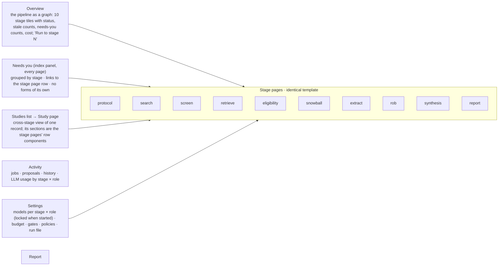

# 04 · The refactor plan (pipeline, graph, operations, UI, models, agentic use)

This is the target design and the order in which to get there. It is written against the as-is
documents (01, 02) and the verified inconsistency list (03). Everything here is a proposal; the
"Decisions to take first" section at the end lists the points where a choice changes the work.

---

## 0. The five rules the refactor enforces

1. **One registry.** Stage keys, labels, order, node types, human-decision kinds, model roles, lock
   rules, tags and UI pages all derive from one `StageSpec` list. Today there are eight parallel lists
   (01 §0.4) and they disagree.
2. **Everything that influences an output is a node with edges.** No `store.meta` key, file or flag may
   change what the pipeline or the UI does without the graph seeing it. "Out of date" is then always a
   version comparison, and the preview before a change is always complete.
3. **One operation, one function, one place.** Every thing a person or the agent can do is an
   `Operation` with one implementation; the CLI, the stage page, the study page and the To-do index all
   call it. Nothing is duplicated with slightly different effects.
4. **Every stage page has the same controls, and no control exists outside a stage page** except the
   cross-stage views (Overview, Studies, Activity, Settings, Report), which link to stage pages.
5. **Every change to an earlier stage shows its reach first.** The dependency preview (what goes stale,
   what is kept because a person decided it, what it will cost) is a mandatory step of every write
   operation that has descendants, in every entry point.

---

## 1. Canonical vocabulary (decide once, generate everywhere)

### 1.1 Stages

| # | key | label | produces | LLM | human decisions of this stage |
|---|---|---|---|---|---|
| 1 | `protocol` | Protocol | `protocol`, `crit:*`, `approval:protocol` | writer | approve; edit criteria; ask for a change |
| 2 | `search` | Search | `strategy`, `search`, `rec:*` | writer | confirm the query (optionally required) |
| 3 | `screen` | Title/abstract screening | `screen:<rid>` | writer (+verifier in `all` mode) | restore a rule exclusion |
| 4 | `retrieve` | Full texts | `ft:<rid>` | none (tools) | supply a file; declare not obtainable; decide without it |
| 5 | `eligibility` | Full-text screening | `elig:<rid>`, `cohort` | writer + verifier | include / exclude an undecided record; overturn a decision |
| 6 | `snowball` | Citation chasing | `snowball`, `rec:*` | none (records only; stages 3-5 screen them) | – |
| 7 | `extract` | Data extraction | `ext:<rid>` | writer + verifier (upward check) | edit a value; re-run one study |
| 8 | `rob` | Risk of bias | `rob:<rid>` | writer + verifier (flagged) | confirm; change domains; re-run one study |
| 9 | `synthesis` | Synthesis | `syn:S*` | writer + verifier (self-check) | edit a statement; resolve a flag |
| 10 | `report` | Report | `report` | none | – |

Changes from today: `plan` → `protocol`; the `fulltext` stage is split into `retrieve` (tools, human
supply) and `eligibility` (an LLM decision), which is how PRISMA 2020 counts it and how the To-do list
already splits it; `synthesize` → `synthesis`; the `feedback` pseudo-stage disappears (its work is
attributed to the stage of the node it revises, see §6).

### 1.2 Roles

| role | what it does | config |
|---|---|---|
| `writer` | produces a stage's output (and revises it when a dependency changed) | `models.<stage>.writer` → `models.default.writer` |
| `verifier` | second reading of items that have a reason (undecided, flagged, doubted); never a blanket pass unless a stage's `verify: all` is set | `models.<stage>.verifier` → `models.default.verifier` |
| `judge`, `judge2`, `reviewer` | evaluation only | `eval.models.*` |

Every LLM call carries `(stage, role, operation)`; cost, cache and locks key on that triple. The
`job_agent` override becomes an explicit per-operation parameter `model` that applies to **that
operation's writer call only**.

### 1.3 Record states (one word each, same everywhere)

```
identified ─► excluded (rule | title-abstract | full-text | person)
           └► forwarded ─► not_retrieved | unreadable | declared_unobtainable | retrieved
                                                                      └► undecided ─► included | excluded
```

`decided_by ∈ {rule, agent, verifier, policy, person}` is a field, never a different state. "Pending"
in the UI means `forwarded ∧ ¬retrieved` or `undecided`.

### 1.4 Node statuses and update verbs

Statuses: `active`, `inactive(reason ∈ excluded | superseded | retired)`.
Update verbs (the engine's whole vocabulary): `rederive` (deterministic), `recompute` (the stage's
writer runs again on the item; optional `scope`, e.g. the changed criteria), `revise` (a targeted LLM
revision given the upstream diff), `retire`, `reactivate`, `render`. "kept" is a *result* (the item is
pinned by a person), not a verb.

---

## 2. Target pipeline



Every stage implements one small interface, and the runner, the engine, the UI and the CLI only use
this interface:

```python
class StageSpec:
    key: str; label: str; order: int
    produces: list[NodeType]            # node types this stage writes
    consumes: list[NodeType | Setting]  # declared edges (tested against what is written)
    roles: set[Role]                    # writer / verifier / none
    gate: Gate | None                   # a human gate before the stage (approval, strategy, pdfs)
    decisions: list[DecisionKind]       # human decisions that belong to this stage's page

    def items(store) -> list[Item]      # work lacking a current output (resume = run)
    def run(ctx, items)                 # batch, parallel, resumable
    def recompute(ctx, item, scope=None)# one item (per-study re-run, engine recompute)
    def rederive(store, item)           # deterministic re-derivation, if the stage has one
    def clear(store, items=None)        # retire this stage's outputs (engine previews the cascade)
    def status(store) -> StageStatus    # not_started | running | done | stale(n) | needs_you(n)
```

`items()` is what makes "run", "re-run", "clear and re-run" and "continue after a human decision" the
same thing: run processes whatever has no current output; clear retires outputs so that `items()` grows;
a human decision pins an item so that `items()` skips it.

---

## 3. Target dependency graph



What this removes: `meta.search_strategy` (→ `strategy`), `meta.protocol_approved/revisions`
(→ `approval:protocol` + protocol history), `meta.synthesis_considered` (→ `cohort` edge),
`meta.snowball/found_via` (→ `snowball` node + `rec.found_via`), `meta.pdf_wanted/pdf_unavailable/
waiting_for_pdfs` (→ fields of `ft:<rid>` and the retrieve gate), `meta.rules_applied` (→ `cfg:screening_rules`
edge), the `awaiting` / `manual_edit` / `reassess` / `source_changed` flag state machines (→ derived
from staleness and `decided_by`), `protocol.yaml` as an input (→ export only; "import protocol.yaml" is
an explicit operation). What stays in `meta`, explicitly labelled *presentation state*: `snoozed`,
`comments`, `config_lock`.

Two rules of the store API that make staleness exact:

```python
store.write(node_id, type, data, consumed: dict[str,int], actor, reason)   # a recompute: records the
                                                                          # versions it actually used
store.annotate(node_id, data_patch, actor, reason)                        # a human decision / confirm /
                                                                          # edit: new version, consumed
                                                                          # versions UNCHANGED, decided_by=person
```

Today one `upsert` serves both and therefore marks a human decision as "current with every input"
([store.py:100](../../sragent/store.py#L100)). With the split, a person's decision on a record whose
protocol later changes is still reported stale (and kept, with the agent's fresh reading beside it).

The engine keeps its shape (plan → execute in rounds, policy per type, sandbox proposals) but:
every entry point calls it the same way (`engine.update(ctx, roots=None, mode=apply|propose, policy=cfg)`),
`pipeline` and `pdfs` stop bypassing the policy, and the "missing outputs" branch disappears because
`items()` of each stage covers it.

---

## 4. Operations: one function per thing a person or the agent can do

```python
@operation("eligibility.decide", stage="eligibility", kind="human", reach=True)
def decide(ctx, rid, decision: Literal["include","exclude"], criterion=None, note=""): ...
```

The decorator gives every operation, for free and identically: mode check (`agent_only` refuses human
kinds), the dependency preview (`reach=True`), provenance + `human_decisions.jsonl` lines with one id
scheme, serialization through the single store lease, job submission for `kind="llm"` operations, a
CLI subcommand (`sragent op eligibility.decide --rid … --decision include`), an HTTP endpoint
(`POST /api/op {"name": "eligibility.decide", …}`), and a row in the Activity log.

| stage | operations (human) | operations (agent / LLM) | operations (deterministic) |
|---|---|---|---|
| protocol | `approve`, `edit_criteria`, `import_file` | `draft`, `revise(instruction)` | `export_file` |
| search | `confirm_strategy(query)`, `clear_strategy` | `draft_strategy`, `suggest_variants`, `refine(instruction)` | `count(query)`, `run` |
| screen | `restore_rule_exclusion(rid)` | `run`, `recompute(rid, model?)`, `verify(rids)` | `rederive`, `apply_rules`, `clear` |
| retrieve | `declare_unobtainable(rid)`, `decide_without(rid)`, `request(rid)` | – | `fetch(rids)`, `process_added_files`, `clear` |
| eligibility | `decide(rid, …)` (also overturns an earlier decision) | `run`, `recompute(rid, model?)`, `verify(rids)` | `rederive`, `clear` |
| snowball | – | – | `run(rounds)`, `clear` |
| extract | `edit_values(rid, fields)` | `run`, `recompute(rid, model?, note?)` | `revalidate_terms`, `clear` |
| rob | `confirm(rids)`, `edit_domains(rid, changes)` | `run`, `recompute(rid, model?, note?)`, `verify(rids)`, `redraft_all` | `clear` |
| synthesis | `edit_statement(sid, …)`, `resolve_flag(flag, ok|fix)` | `write`, `update` (engine on this stage), `revise(sid, instruction)` | `clear` |
| report | – | – | `render`, `export` |
| cross-stage | `comment(target, send?)`, `snooze(item)`, `proposal.accept/reject`, `propagate_edit(node)`, `settings.change(…)`, `models.set(stage, role, model)` | `feedback(text, target?)`, `update_all` (engine over everything) | `preview(node)`, `stop`, `cancel(job)` |

This table replaces: four protocol-edit paths, three RoB re-assessment paths, two eligibility paths
with different vocabularies, two PDF paths, the `/api/answer` + `/api/bulk` + `/api/edit` trio,
and the CLI-only commands that have no UI (`verify-screening`, `verify-rob`, `revalidate-terms`,
`fetch-files`) — all become operations visible on their stage page.

Write serialization: one store lease per run folder. LLM operations run in a subprocess that holds
the lease; human/deterministic operations wait for the lease (bounded, with a visible "queued" state) and
are applied **against the node version the person saw** (a `base_version` check, as proposals already
have); a conflict is reported back to the person, never dropped into a log file. No LLM call ever runs
in an HTTP thread.

---

## 5. The UI: one page per stage, three cross-stage views, one preview component



### 5.1 The stage page template (every stage, same places, same words)

```
┌──────────────────────────────────────────────────────────────────────────────────────────┐
│ 5 · Full-text screening                      status: stale (3) · needs you (2)            │
│ writer: claude-sonnet-5-5 (high, fixed)  verifier: gpt-6.1-sol  spent $1.84  pending ≈ $0.12│
├──────────────────────────────────────────────────────────────────────────────────────────┤
│ [Run pending (3)] [Re-run all (fresh)] [Clear stage…] [Verify undecided] [Stop]           │
├─ Inputs ──────────────────────────┬─ Dependents ────────────────────────────────────────┤
│ screen (TA)  v12 · current        │ cohort → extract 14 · rob 14 · synthesis 8 · report  │
│ full texts   v30 · 2 changed →    │ A change here reaches: 2 extractions, 1 statement     │
│ criteria     v4  · changed: I3 →  │ (1 kept: your decision on 31003963)                   │
├─ Items (153) ──────────────────────────────────────────────────────────────────────────────┤
│ filter: [all | undecided | included | excluded | stale | decided by person]               │
│ rid       title…             decision    by       stale  evidence   actions               │
│ 30230257  Relative and …     included    agent    –      I1 I2 I3 ✓ [re-run ▾][overturn]   │
│ 32603420  First report of …  undecided   –        –      I3 ?       [include][exclude]     │
│ …                                                                                        │
├─ Needs you (2) ─────────────────────────────────────────────────────────────────────────┤
│ the same two rows, pre-filled suggestion, one Save                                       │
├─ Jobs of this stage ─────────────────────────────────────────────────────────────────────┤
│ 19:12 run pending (3) · done · $0.11 · log                                               │
└──────────────────────────────────────────────────────────────────────────────────────────┘
```

Fixed meaning of the five toolbar buttons on every stage:

| button | operation | preview? |
|---|---|---|
| Run pending (n) | `<stage>.run` on `items()` | cost only |
| Re-run all (fresh) | `<stage>.clear` + `run`, cache off | yes (cascade) |
| Clear stage… | `<stage>.clear` | yes (cascade), then the stage shows "not started" and downstream shows stale |
| Verify … | `<stage>.verify` on items with a reason (stages that have a verifier) | cost |
| Stop | `stop` (this run folder's job) | – |

The "Items" table is the single place where this stage's human decisions are made; the "Needs you"
section is a filtered view of the same table, and the global "Needs you" panel is a list of links into
it. The study page shows the same row component for each stage, so an edit there **is** the stage-page
edit (one operation, one form).

### 5.2 The dependency preview (the component shown before any write with reach)

```
┌─ Before you save ──────────────────────────────────────────────┐
│ Exclude 30230257 (your decision)                               │
│                                                                │
│   elig:30230257 ──► cohort ──► syn:S2, syn:S5 (revise)         │
│                       └──► ext:30230257, rob:30230257 (retire) │
│                       └──► snowball (stale: seeds changed)     │
│                                                                │
│ 2 statements to revise (≈ $0.03) · 2 outputs retired (free)    │
│ kept: nothing                                                  │
│ policy: synthesis = propose (you will approve the revision)    │
│                      [Cancel]  [Save and update now]  [Save only] │
└────────────────────────────────────────────────────────────────┘
```

Built from `engine.preview` (already exists) plus a small graph rendering of the reach; used by every
operation with `reach=True`: decisions, edits, protocol and criteria changes, strategy changes, settings
changes, clear / re-run of any stage. The preview is the user-facing form of rule 2 (everything in the
graph), which is why §3 must land before §5.

### 5.3 What disappears

The Run page (its parts move: "what to run" → Overview "Run to stage" + each stage's toolbar; models →
Settings; budget → Settings; job log → Activity and the stage page). The To-do page as a page (becomes
the "Needs you" index). The Full texts page (becomes the `retrieve` stage page, unchanged in content).
`/api/answer`, `/api/bulk`, `/api/edit`, `/api/protocol`, `/api/search_strategy`, `/api/data_items`,
`/api/rerun`, `/api/propagate`, `/api/comment*` (→ `/api/op`). The hover-only "Run to here".

---

## 6. Models, roles and what each one sees

Config shape:

```yaml
models:
  default: {writer: claude-haiku-5-5, verifier: gpt-6.1-sol}
  protocol:  {writer: {model: claude-sonnet-5-5, effort: high}}
  synthesis: {writer: {model: claude-sonnet-5-5, effort: high}}
eval:
  models: {judge: gemini-3.1-pro-preview, judge2: gpt-6.1-sol, reviewer: gemini-3.8-flash}
```

Resolution is one function `model_for(stage, role, override=None)`; the Settings page is a table
stage × role; a cell locks when the stage has produced its first output; the verifier cell of a stage
locks with it. Cost attribution and the cache key use `(stage, role)`; the estimate reads the registry's
call shapes instead of a hand-maintained table.

Information fixes that fall out of the registry (see 05 §3 for the current matrix):

- the upward eligibility check reads the same text budget the extractor read, not 15k;
- `SEARCH_REFINE` gets the validated synonyms like the other two search prompts;
- the synthesis writer and checker see each study's source kind (abstract vs full text) and the
  retrieval coverage note it is already asked to respect;
- a re-run note is attached to the targeted writer call only, not to every verifier and dependent
  revision of the job;
- the verifier is **blind by default** (it reads the record and the criteria, then its answer is
  reconciled with the writer's); "anchored" (sees the writer's answer) is a per-stage option, because
  today every second reading is anchored and that is not an independent check;
- scope stays as the memory rule says: verifier only for items with a reason (undecided, flagged,
  doubted); the person only when both disagree.

---

## 7. Using the agentic system better (what the model could do that it cannot today)

Today every model call is one prompt with a hand-packed context and one JSON answer. The places where
that limits quality, and the agent shape that fixes each:

| today | proposal |
|---|---|
| Feedback is one FEEDBACK_VERIFY call over a 40k-char cut of the source; IMPACT candidates are cut to 1,500 chars each; REVISE_DEPENDENT sees 20k | a **tool-using feedback agent**: tools `read_section(rid, section)`, `find_sentences(rid, query)`, `get_output(node)`, `list_dependents(node)`, `pubmed_count(query)`, `fetch_paper(pmid)`; it reads what it needs, writes the revision with sentence ids it actually looked up, and the trace is stored with the proposal |
| Evidence coverage is a regex pass (`cover_numbers`) that auto-cites sentences | an **evidence locator tool** the extractor can call (`find_sentences`) during extraction, so a number is cited because the model found it, not because a regex did; `uncovered` stays as a marker of what the model could not place |
| Protocol and search chat are single calls in the HTTP thread with a fixed menu of chips | a **planning session** per stage (a short tool-using loop: count on PubMed, show a sample of hits, compare two queries) run as a job with a live transcript on the stage page |
| "Update now" shows plan lines generated by code | a **plan narrator**: one cheap call that explains the engine plan in two sentences and names what it will not touch and why (pinned items), shown in the preview |
| Verifier reads the writer's answer | **blind second reading + reconciliation** (two calls) where the stage asks for it; disagreement goes to the person with both readings |
| Stage completion is silent | an optional **stage audit** (cheap model) after screening and extraction: "which excluded records look eligible", "which values look inconsistent across studies" → flags with a reason, verifier, then person (same escalation rule) |
| Prompts are strings matched by substring in `tests/mock_llm.py` | prompts as **versioned templates with declared inputs**; the mock matches on the template name; the cache key includes the template version |

None of these change the human-in-the-loop contract: proposals, pinned decisions and the escalation
"reason → verifier → person" stay as they are.

---

## 8. Migration, in phases that each leave the review working

| phase | what | done when | risk |
|---|---|---|---|
| 0 · Freeze | keep `tests/golden/*`; add characterization tests for every operation through the new `ops` layer as it appears (one per row of §4) | every golden passes on the old and the new path | none |
| 1 · Registry and vocabulary | `StageSpec` registry; derive `todos.STEPS`, `config.LLM_STAGES`, `config_lock.STAGE_STARTED`, `engine.STAGE_FOR/ORDER`, tag prefixes and the UI `STAGES` from it; rename keys with a compatibility map for old run files; delete dead constants | one list in the code; the Overview shows ten stages | low |
| 2 · Graph | `store.write` / `store.annotate`; new nodes (`strategy`, `approval:protocol`, `cohort`, `elig:*`, retrieval state on `ft:*`, `cfg:fulltext_unclear`); schema-3 migration that moves every `meta` key in 01 §13 into nodes; engine verbs reduced to six; a test that declared edges equal written edges for every producer | `graph.stale` explains every "out of date" in the UI; no `meta` key is read by a stage | medium (migration of existing runs; keep `.bak`) |
| 3 · Operations | the `@operation` layer; CLI and HTTP wrappers; the single store lease; move the four protocol paths, three RoB paths, two eligibility paths, two PDF paths onto single operations; uniform provenance and decision logging; no LLM in HTTP threads | every row of §4 exists once; `sragent op --list` and `/api/op` are the only mutation entry points | medium |
| 4 · UI | stage page template + ten pages; "Needs you" index; study page built from stage row components; dependency preview everywhere; Settings page; remove Run / To-do / Full texts pages | the stage × control matrix (02 §3) has no empty cell | medium (the one-file front end becomes a small set of modules) |
| 5 · Models | `models.<stage>.<role>`; `model_for`; cost and cache keyed by (stage, role); locks per cell; estimate from the registry; blind verifier option | 05 §1 is one function; the Activity usage view is by stage × role | low |
| 6 · Agentic | tool-using feedback agent; evidence locator; planning sessions; plan narrator; stage audits | each behind a setting, default on for real reviews | medium (cost; measure with the benchmark before switching the default) |

Phase 0 status (2026-11-05): `tests/test_operations.py` pins 63 entry points under the operation each will become (snapshots in `tests/golden/ops/`: result, decision log, provenance, flags opened/closed, proposals, model calls by tag, what is out of date afterwards); `test_every_operation_is_accounted_for` checks that every operation of §4 is covered, marked new, or marked as a gap (snowball run, model settings, stop/cancel).

Phase 1 status (2026-11-05): `sragent/stagespec.py` is the one list of stages (ten: protocol, search, screen, retrieve, eligibility, snowball, extract, rob, synthesis, report). The pipeline order and `--until` choices, `config.LLM_STAGES` / `STAGE_LABELS` / `stage_of_tag`, `config_lock.STAGE_STARTED`, `todos.STEPS`, the Overview rows and the browser's stage list (`/api/state` → `registry`) are derived from it. `fulltext` is split into `retrieve` (no model calls) and `eligibility`; `plan` → `protocol`, `synthesize` → `synthesis`. Earlier keys are accepted in run files (`stage_models`, `skip_stages`), `--until`, and in the models recorded in older reviews (renamed in place on load). Model-call tags are unchanged (usage history). Removed: `engine.ORDER`, `engine.STAGE_FOR`, `sync.update_synthesis`. Addresses 03: I37, I39, I50 (in part: the phantom `evidence_check` flag source remains), I40 and I52 (in part: snowball and report now have Overview rows). Left for later phases: separate `elig:<rid>` nodes (phase 2), `feedback` as a model slot until `model_for(stage, role)` (phase 5).

Phase 2 status (2026-11-05): 2a done (`store.write` / `store.annotate`; declared edges checked after every operation). 2b done: protocol approval, search strategy, cohort, synthesis scope, citation chasing, full-text requests and the rules last applied are nodes (`sragent/state.py`), with edges; rule exclusions depend on `cfg:screening_rules`; `cfg:fulltext_unclear` is a settings node; schema 3 migrates older reviews on load (backup `store.schema2.bak.json`). Two deviations from §3: full-text requests are `pdf:<rid>` nodes, not fields of `ft:<rid>` (a request is not a new full text, and screening, extraction and RoB depend on `ft:<rid>`); `protocol_revisions` stays in meta as the card's conversation history. 2c done: full-text decisions are `elig:<rid>` nodes (type `eligibility`), title/abstract decisions stay on `screen:<rid>`; `sragent/selection.py` gives each study's decision node and combined record; retrieval failures are derived from `ft:<rid>`, not stored as decisions; a person's eligibility decision is recorded on `elig:<rid>`; extraction depends on `elig:<rid>`; schema 4 splits older reviews on load (backup `store.schema3.bak.json`), checked on seven scenarios built with the previous code and on four real reviews (identical eligibility, PRISMA and outputs). 2d done: the engine plans with six verbs (`rederive`, `recompute` with an optional criteria scope, `revise`, `retire`, `reactivate`, `render`) and two results (`kept`, `current`); the awaiting, included-by-policy, differs-from-your-decision, source-changed and your-edit notices are derived from the graph (`sragent/attention.py`) instead of flags opened and resolved by hand; answering "they are fine" to an edit marks its dependents current; a proposal that re-checked a node and found it unchanged now makes it current when accepted; schema 5 closes the stored flags of those kinds (identical open items on four real reviews). Phase 2 is complete.

Phase 3 status (2026-11-05): `sragent/ops` registers every operation of §4 that exists today (55; `sragent op --list`), each with one implementation and the same handling (mode check, one decision-log line and one provenance record named after the operation, save). The To-do answers, bulk saves, study-page edits, protocol and search cards, comments and every CLI command that changes a review call these operations: two eligibility paths, three RoB paths (I05, I06), five protocol paths (I08), two PDF paths and the answer/bulk/edit trio are one each. `protocol.yaml` is an export: a hand edit is applied only by `protocol.import_file` (a run stops and asks). Model operations run as jobs (`POST /api/op` queues `sragent op NAME` in a subprocess); protocol revise and search suggest/refine from the page are jobs too. One writer per run folder (`sragent/lease.py`). Left for phase 4: the page still sends the older request shapes (`/api/answer`, `/api/bulk`, `/api/edit`, ...), translated to operations in `App._apply_op`; they are deleted when the page sends `/api/op` only. The model-connection test in Settings (`/api/test_model`) still calls a model in the request: it tests a connection, it is not a review operation.

Phase 4 status (2026-11-05): 4a done (the backend of the stage pages): `<stage>.clear` and `<stage>.rerun_all` (fresh model answers) for screen, eligibility, extract, rob and synthesis (`sragent/ops/stage.py`; kept: what a person decided, confirmed or edited, and rule exclusions; not offered for protocol, search, retrieve, snowball and report, with the reason shown); `run` operations take `fresh`; `ops.preview` applies any person's or deterministic operation to a copy of the review in a scratch folder and returns what it changes, what becomes out of date, what a person's decision keeps and the cost (`POST /api/preview`); `sragent/ui/stagepage.py` builds every stage page from one template (`GET /api/stage?key=`): header, the five-button toolbar, inputs, dependents, items with their row operations, needs you, jobs; `GET /api/needs_you` groups the waiting items by stage. 4b (the page itself) and 4c (removing the Run, To-do and Full texts pages and the older endpoints) to do.

Order matters: 1 before everything (names), 2 before 4 (the preview needs the graph), 3 before 4
(pages call operations), 5 can run in parallel with 4, 6 last.

Evaluation discipline (per the project's own rule): no paid benchmark run until a phase is complete;
then one agent-only run of `benchmark/emicizumab_pk` compared with the v3 results row in
`docs/RESULTS.md`, before the phase is merged.

---

## 9. Decisions to take first

Decided on 2026-11-05: all six as recommended below.

1. **Split `fulltext` into `retrieve` and `eligibility`** (recommended: yes; PRISMA counts them apart,
   the To-do already does, retrieval has no LLM).
2. **Separate TA and FT screening nodes** (`screen:<rid>` and `elig:<rid>`) instead of one node with a
   `stage` field (recommended: yes; it is what makes stage 3 and stage 5 "clear and re-run" independent).
3. **`protocol.yaml` becomes an export** with an explicit import operation (recommended: yes; today a
   file edit is detected only on the next run and logged as the agent's change).
4. **Remove the Run page** in favour of stage toolbars + Settings (recommended: yes).
5. **Keep the CLI as a generated wrapper** of operations (`sragent op …`) plus the few whole-review
   commands (`run`, `status`, `eval`, `ui`) (recommended: yes).
6. **Verifier blind by default** (recommended: yes, with the anchored mode kept per stage for cost).

---

## 10. Which issues of 03 each phase removes

Issue ids refer to 03 §2; an issue with two reasons appears under both phases; refuted candidates are excluded.

| phase | reasons (03 §1) | issues |
|---|---|---|
| phase 1 · Registry and vocabulary | R1 | 22: I30, I35, I36, I37, I38, I39, I40, I48, I50, I52, I72, I73, I74, I75, I76, I77, I78, I79, I80, I81, I83, I84 |
| phase 2 · Graph | R2, R3 | 42: I03, I04, I07, I09, I11, I17, I26, I29, I31, I32, I33, I40, I42, I43, I45, I46, I49, I51, I53, I54, I55, I56, I57, I58, I59, I60, I61, I62, I63, I64, I65, I66, I67, I68, I69, I70, I71, I78, I80, I103, I105, I106 |
| phase 3 · Operations | R4, R5, R8 | 44: I01, I02, I03, I04, I05, I06, I07, I08, I10, I11, I12, I13, I14, I15, I16, I18, I19, I20, I23, I24, I25, I26, I27, I28, I29, I30, I31, I32, I34, I41, I55, I57, I63, I66, I71, I84, I85, I89, I96, I97, I102, I105, I107, I111 |
| phase 4 · UI | R7 | 17: I13, I14, I25, I27, I28, I30, I40, I45, I49, I52, I70, I81, I82, I99, I100, I101, I106 |
| phase 5 · Models | R6 | 15: I06, I21, I22, I34, I35, I36, I44, I47, I48, I65, I76, I77, I86, I95, I98 |
| phase 6 · Agentic and verifier | R9 | 11: I68, I77, I86, I87, I88, I90, I91, I92, I93, I94, I104 |
| every phase · docs regenerated | R10 | 4: I108, I109, I110, I112 |
