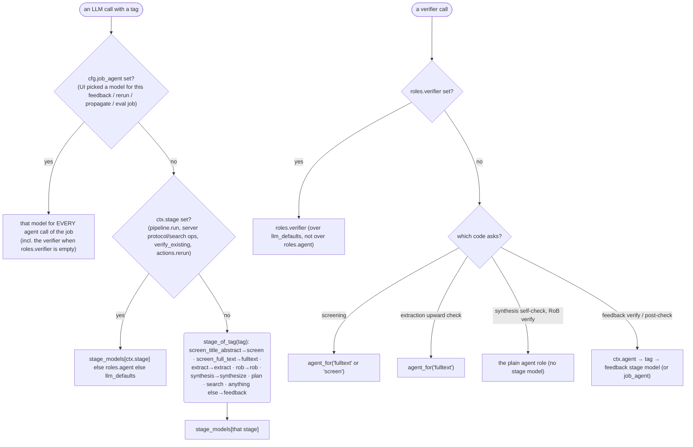

# 05 · Models, roles, tools: who sees what, at which stage

Condensed from `sragent/prompts.py`, `llm.py`, `config.py`, `context.py`, the stage modules and
`sources/`. Line references are to the current code.

---

## 1. How a model is chosen for a call (today)

Consequences: the same role is resolved by seven pieces of code; cost is attributed by tag prefix, so
`screen_verify_*`, `eligibility_verify`, `vision_page` and every engine revision started from a pipeline
run are booked to "feedback"; inside the `screen` stage the engine's extraction/RoB/synthesis work runs
on the screen model; after any Run-page job the last agent selection becomes `job_agent` for every
later feedback / re-run / propagate job that names no model.

The disk cache key is `(provider, model, messages, json, temperature, max_tokens, reasoning_effort,
extra_body)`: the reviewer note is in `messages`, so a note changes the key; role, tag and stage are not.

---

## 2. Roles and stages (as configured and as used)

| Role | Config key | Default | Used for |
|---|---|---|---|
| agent (per stage) | `stage_models.<plan|search|screen|fulltext|snowball|extract|rob|synthesize|feedback>` → `roles.agent` → `llm_defaults` | gpt-6.1-sol | every writer call; "feedback" also serves sync, pdfs, engine revisions, DECOMPOSE/IMPACT/INTEGRATE, injector prompts in eval |
| verifier | `roles.verifier` | empty = fallbacks above | SCREEN_VERIFY, ELIGIBILITY_VERIFY, ROB_VERIFY, SYNTH_VERIFY (stage and feedback), FEEDBACK_VERIFY, SOURCE_CHECK |
| judge, judge2 | `roles.judge`, `roles.judge2` | empty | `sragent eval` only (JUDGE_*, SOURCE_CHECK, SYNTH_VERIFY, CONSISTENCY, FIELD_JUDGE) |
| reviewer | `roles.reviewer` | empty (agent, warned) | Claim 1 simulated reviewer |
| job agent | `job_agent` (written by the UI per job) | – | overrides all of the above for one subprocess |
| vision | none | the current stage's model, else feedback | page transcription without Azure |

Locked once a stage started: `stage_models.<stage>` for the eight pipeline stages; never locked:
`feedback`, every role.

---

## 3. What each model sees (stage × information)

Y = seen · P = partly · N = not seen. "Writer" is the stage model, "Verifier" the role above.

| Operation (prompt · model) | Question / PICO | Criteria | Synonyms | Record (title+abstract) | Full text (how much) | Own previous output | Other studies | RoB | Human text | Human decision | The writer's answer |
|---|---|---|---|---|---|---|---|---|---|---|---|
| Draft protocol (PLAN · plan) | Y question | N | N | N | N | N | N | N | Y seed text | N | – |
| Revise protocol (PLAN_REVISE · plan) | Y | Y all | Y validation | N | N | Y whole protocol | N | N | Y instruction | N | – |
| Build query (SEARCH_QUERY · search) | Y question + PICO | **N** | Y ≤12/concept | N | N | N | N | N | N | N | – |
| Alternatives (SEARCH_VARIANTS · search) | Y | N | Y | N | N | Y V0 + count | N | N | N | N | – |
| Refine query (SEARCH_REFINE · search) | Y | N | **N** | N | N | Y query + count | N | N | Y instruction | N | – |
| TA screen (SCREEN · screen or snowball) | **N** | P TA-stage, non-practical | Y ≤15 | Y | N | N | N | N | note on re-run only | N (kept by code) | – |
| FT screen (SCREEN · fulltext or snowball or screen) | N | P non-practical, all stages | Y | N | P 15k chars, section-prioritised | N | N | N | note on re-run | N (kept by code) | – |
| Re-assess changed criteria (SCREEN subset) | N | **only the changed ones** | Y | Y/P | P 15k | N (code merges) | N | N | N | N (kept) | – |
| Verifier screen (SCREEN_VERIFY · verifier) | N | P | Y | Y/P | P 15k | N | N | N | note leaks on re-run | N | **Y assessments + decision** |
| Extract (EXTRACT · extract) | Y question | Y all non-practical | N | abstract only if no text | Y 60k or every part | N (edited values re-attached by code) | N | N | note on re-run | N | – |
| Merge parts (EXTRACT_MERGE · extract) | N | N | N | N | **N** (candidates + their sentences) | own candidates | N | N | N | N | – |
| Upward eligibility check (ELIGIBILITY_VERIFY · verifier) | N | **one criterion** | N | N | **P 15k** (the extractor read 60k) | N | N | N | N | N (kept) | Y screener's assessment + extractor's doubt |
| RoB (ROB · rob) | N | N | N | N | Y 60k single pass | N (confirmed skipped) | own values only | – | note on re-run | N | – |
| Verifier RoB (ROB_VERIFY · verifier) | N | N | N | N | Y 60k | N | own values | Y draft | N | N | Y draft + reasons |
| Synthesis (SYNTH · synthesize) | Y question | N | N | N | N | N | Y all values (no quotes, no source kind) | Y overall + domains | N | N | – |
| Self-check (SYNTH_VERIFY · verifier) | N | N | N | N | N | Y statement | Y cited values + quotes (+ all for absence claims) | **N** | N | N | – |
| Repair (SYNTH_REPAIR · synthesize) | N | N | N | N | N | Y | Y as above | N | N | N | Y check result |
| Locate feedback (DECOMPOSE · feedback) | N | N | N | N | N | N | one line per EVERY active output | Y (summary) | Y feedback | N | – |
| Verify feedback (FEEDBACK_VERIFY · verifier) | N | Y all incl. practical (screen targets) | N | per source | P 40k | Y target view | synthesis: cited values + quotes | N | Y feedback | N | – |
| Apply without check (FEEDBACK_APPLY · feedback) | N | N | N | N | **N** | Y target | N | N | Y feedback | N | – |
| Which outputs are affected (IMPACT · feedback) | N | N | N | N | N | Y before/after [:3000] | Y candidates [:1500] | P | Y reason [:500] | N | – |
| Revise a dependent (REVISE_DEPENDENT · feedback) | N | N | N | N | P cut to 20k | Y node + upstream before/after | synthesis: cited values + quotes | N | note on re-run | N | – |
| Integrate a study (SYNTH_INTEGRATE · feedback) | **N** | N | N | N | N | Y all statements + revived history | Y new study + all values | **N** | N | N | – |
| Post-check (SOURCE_CHECK / SYNTH_VERIFY · verifier) | N | N | N | N | Y 60k | Y value / statement | cited values + quotes, **no absence block** | N | N | N | – |
| Global audit (CONSISTENCY · feedback) | N | N | N | N | N | Y all statements | Y all values [:350] | N | N | N | – |
| Vision transcription (inline · stage or feedback) | N | N | N | N | one page image | N | N | N | N | N | – |
| Eval judges (JUDGE_* · judge/judge2) | N | N | N | N | P | Y | Y | N | N | N | **Y gold / planted** |
| Simulated reviewer (REVIEWER_TASK · reviewer) | Y report | Y report | N | report | P sources [:cap] | – | Y bundle | Y bundle | N | – | N (planted hidden) |

Deliberately hidden from the models: benchmark gold labels (stripped before the store); cost, budget,
model names; the person's identity; the human decision itself (kept beside the fresh output by code);
flags and evidence markers (except the reasons given to ROB_VERIFY and the check results given to repair
prompts). Shown to every verifier: the writer's answer (second readings are anchored, not blind).

Human text that enters prompts verbatim: seed eligibility text, protocol and search instructions, the
re-run / propagate note (appended to **every** prompt of that job, including verifier and dependent
revisions), feedback and comment text, supplied PDFs and supplements, field and domain descriptions
from `topic.yaml`.

---

## 4. Tools and external services (who calls them, from which stage)

| Tool | Endpoint | Used by | Credentials / settings | Cache | Failure → fallback |
|---|---|---|---|---|---|
| NCBI E-utilities esearch / efetch / elink | eutils.ncbi.nlm.nih.gov | search (count, run), snowball (fallback, date filter, metadata), feedback "add paper", SYNERGY resolution | `contact_email`, `ncbi_api_key` | HTTP SQLite cache, forever | `count` swallows errors; `search` fails the stage; snowball skips the seed |
| NCBI efetch db=pmc (JATS) | same | fulltext, only when Europe PMC errors | – | forever | "no article either" → OA lookup |
| Europe PMC search + fullTextXML | ebi.ac.uk/europepmc | fulltext (PMCID lookup, JATS text, supplements list) | – | forever (**a 404 is cached forever**) | → NCBI → OA lookup |
| Unpaywall | api.unpaywall.org | fulltext OA locations | `contact_email` (required) | forever | → OpenAlex |
| OpenAlex works / citation graph | api.openalex.org | fulltext OA locations; snowball references + citing | `openalex_api_key`, mailto only after snowball configured | forever | → NCBI elink (snowball) / nothing (fulltext) |
| Publisher / repository PDF download | from Unpaywall/OpenAlex | fulltext | UA with contact email | file `fulltext/auto/<rid>.pdf` | next location; link shown in the PDF request |
| Europe PMC / NCBI PDF render | europepmc.org, pmc.ncbi.nlm.nih.gov | keep fetched files | – | file | `auto_pdf_status` |
| Crossref | api.crossref.org | SYNERGY DOI resolution only | – | forever | record skipped |
| SYNERGY dataset | raw.githubusercontent.com | search (benchmark) | – | `data/<key>_records.jsonl` | stage fails |
| RxNav / RxNorm, PubChem, ChEMBL, MONDO (OLS4) | nlm.nih.gov, pubchem, ebi.ac.uk | plan (key concepts), extract (drug/disease values), `revalidate-terms`, grounding eval | – | lru + HTTP cache | a network error is reported as `not_found` |
| Azure Content Understanding | your endpoint | PDF parsing when keys present (`pdf_parser auto|azure_cu`) | `azure_cu_endpoint`, `azure_cu_key`, `azure_cu_api_version`, `azure_cu_analyzer` | `fulltext/.parsed/*.json` (key ignores api version) | → pdftotext |
| pdftotext (poppler) / pypdf | local | PDF parsing fallback; page detection for vision | – | – | pypdf; then `parse_failed` |
| pdftoppm + the stage's multimodal model | local + LLM | `vision_pages: true` without Azure | – | LLM cache | text kept without transcription |
| rapidfuzz | library | dedup (title ≥95), quote → sentence (≥80), ChEMBL match | – | – | substring fallbacks |

Deterministic components (no LLM): screening rules (`rules.classify`), de-duplication (`search.dedup`),
record ids (`synergy.rid_for`), sentence segmentation and section-prioritised packing (`evidence`),
evidence resolution (ids or fuzzy quotes, ≤8), number coverage (`cover_numbers`), the screening decision
rule (`screening.decide / settle / rederive`), snowball pre-filter, JATS / markdown / PDF to text,
unreadable detection (>1500 / >2000 chars).

---

## 5. Stage → tools in one table

| Stage | LLM prompts (writer) | Verifier prompts | External tools |
|---|---|---|---|
| plan | PLAN, PLAN_REVISE | – | term validation DBs |
| search | SEARCH_QUERY, SEARCH_VARIANTS, SEARCH_REFINE | – | PubMed esearch/efetch, SYNERGY, Crossref |
| screen (TA) | SCREEN | SCREEN_VERIFY (`all` only) | screening rules |
| fulltext | SCREEN (FT) | SCREEN_VERIFY (`pending`, `full_text`, `all`) | Europe PMC, NCBI, Unpaywall, OpenAlex, PDF download, Azure / pdftotext / vision, supplements, provenance hashing |
| snowball | SCREEN (TA + FT, snowball model) | SCREEN_VERIFY (verifier else fulltext/screen model, not snowball) | OpenAlex, NCBI elink/efetch/esearch |
| extract | EXTRACT, EXTRACT_MERGE | ELIGIBILITY_VERIFY | term validation DBs, number coverage |
| rob | ROB | ROB_VERIFY (`flagged`) | – |
| synthesize | SYNTH, SYNTH_REPAIR | SYNTH_VERIFY | – |
| report | – | – | – |
| feedback / sync / pdfs / rerun (outside the registry) | DECOMPOSE, LOCATE, FEEDBACK_APPLY, IMPACT, REVISE_DEPENDENT, SYNTH_INTEGRATE, REPAIR, CONSISTENCY | FEEDBACK_VERIFY, SOURCE_CHECK, SYNTH_VERIFY | PubMed efetch (add paper), all fulltext tools |
| eval | injector prompts (feedback model) | JUDGE_*, SOURCE_CHECK, SYNTH_VERIFY, CONSISTENCY, FIELD_JUDGE (judge roles), REVIEWER_TASK (reviewer) | term validation |
